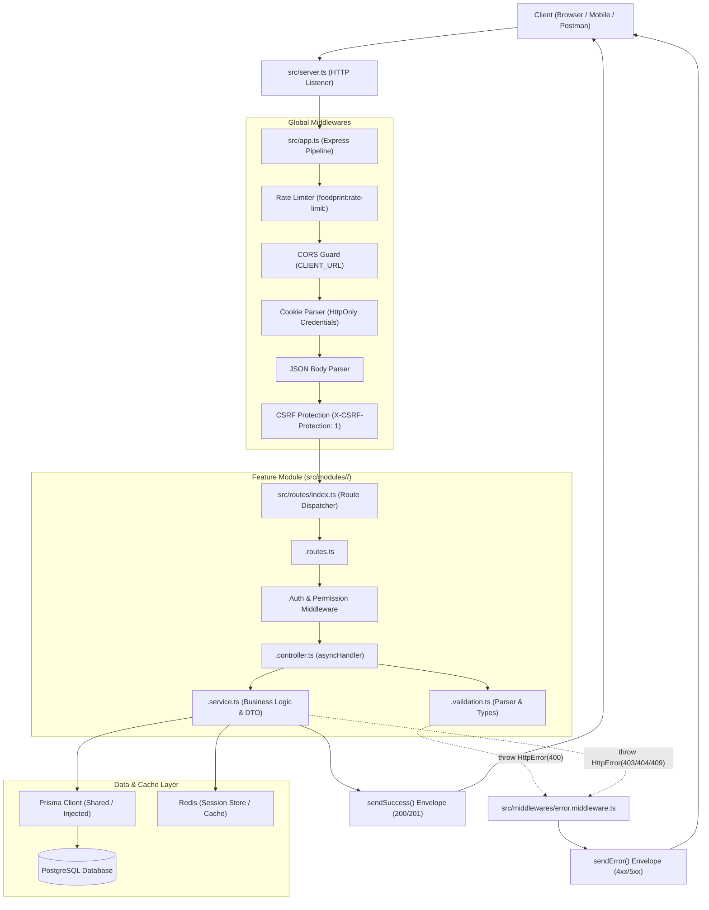

# Hướng dẫn Phát triển Backend FoodPrint

Tài liệu này đóng vai trò là cẩm nang kiến trúc và quy chuẩn phát triển cho toàn bộ thành viên xây dựng Backend FoodPrint (`FoodPrintBE`). Tài liệu bổ trợ cho [AGENTS.md](../AGENTS.md) và [contribute.md](../contribute.md).

---

## 1. Cấu trúc và Kiến trúc Tổng thể của Backend

FoodPrint Backend được xây dựng bằng **Node.js (CommonJS)**, **TypeScript** (Node16 module resolution), **Express**, **PostgreSQL 18** (thông qua **Prisma ORM 7.10**), và **Redis** (quản lý phiên làm việc và rate limiting).

### 1.1. Vòng đời của một HTTP Request (Request Lifecycle)



---

### 1.2. Quy tắc 4 File chuẩn cho mỗi Feature Module

Tất cả các module nghiệp vụ trong `src/modules/<feature>/` bắt buộc phải tuân theo cấu trúc 4 file độc lập với phân định trách nhiệm rõ ràng:

| File                      | Vai trò                         | Trách nhiệm bắt buộc                                                                                                                                                                                                                                                                                                            | Điều cấm                                                                                                                             |
| :------------------------ | :------------------------------ | :------------------------------------------------------------------------------------------------------------------------------------------------------------------------------------------------------------------------------------------------------------------------------------------------------------------------------ | :----------------------------------------------------------------------------------------------------------------------------------- |
| `<feature>.routes.ts`     | Khai báo Endpoint & Middleware  | - Định nghĩa HTTP method (`GET`, `POST`, `PATCH`, `DELETE`).<br>- Gắn middleware bảo vệ (`authenticate`, `requireResource`, `requireRole`).<br>- Khai báo rõ ràng các public endpoint không cần auth.                                                                                                                           | **Không** viết logic controller hoặc truy vấn database trực tiếp trong router.                                                       |
| `<feature>.controller.ts` | Tiếp nhận Request & Phản hồi    | - Bọc toàn bộ handler trong `asyncHandler`.<br>- Gọi hàm validation để lấy dữ liệu sạch.<br>- Gọi service và truyền `AuthPrincipal` (nếu cần phân quyền).<br>- Trả về kết quả qua `sendSuccess(res, data, message, statusCode)`.                                                                                                | **Cấm tuyệt đối** tự gọi `sendError` trong controller handler. Mọi lỗi đều phải ném qua `throw new HttpError(statusCode, message)`.  |
| `<feature>.validation.ts` | Parser & Type Guard             | - Parse và validate query parameters, body hoặc URL params.<br>- Kiểm tra kiểu dữ liệu chặt chẽ (số nguyên dương, UUID format, enum, max length).<br>- Ném `HttpError(400, "Thông báo tiếng Việt")` nếu dữ liệu sai.<br>- Export TypeScript Type tương ứng.                                                                     | **Không** thực hiện truy vấn DB để kiểm tra logic nghiệp vụ phức tạp tại tầng này.                                                   |
| `<feature>.service.ts`    | Nghiệp vụ cốt lõi & Truy vấn DB | - Whitelist `select`: Chỉ lấy các trường cần thiết, tuyệt đối không leak `passwordHash`, QR token, credentials.<br>- Sắp xếp thứ tự ổn định theo khóa chính (`orderBy: [{ id: "asc" }]`).<br>- Map dữ liệu sang DTO chuẩn `camelCase`.<br>- Dùng factory function hỗ trợ Dependency Injection để chạy unit test mà không mở DB. | **Không** đọc dữ liệu vượt quyền hạn (`listScopes`); không dùng `COUNT(*)` toàn bảng khi chỉ cần kiểm tra trang kế tiếp (`hasNext`). |

---

## 2. Quy trình 7 bước chuẩn mực để tạo một API mới

Khi phát triển một API mới (dù là API công khai hay API quản trị bảo vệ), hãy thực hiện tuần tự theo 7 bước sau:

### Bước 1: Khai báo Model / Schema & Migration (nếu có thay đổi Database)

1. Mở [`prisma/schema.prisma`](../prisma/schema.prisma):
   - Tên Model và Enum dùng `PascalCase`.
   - Tên trường dùng `camelCase`, map sang tên cột PostgreSQL bằng `@map("snake_case")`.
   - Luôn gắn `@@schema("foodprint")` và `@@map("table_name")`.
2. Tạo file migration local:
   ```bash
   npm run db:migrate:create -- --name descriptive_change_name
   ```
3. Mở file `migration.sql` vừa sinh trong `prisma/migrations/<timestamp>_<name>/`:
   - Bổ sung các ràng buộc `CHECK`, `FOREIGN KEY`, hoặc `INDEX` điều kiện không thể biểu diễn bằng Prisma.
   - Review kỹ DDL để đảm bảo an toàn dữ liệu.
4. Sinh lại Prisma Client:
   ```bash
   npm run prisma:generate
   ```

---

### Bước 2: Định nghĩa Parser Validation (`<feature>.validation.ts`)

Viết hàm validate độc lập, ném `HttpError(400)` nếu dữ liệu sai định dạng:

```ts
import { HttpError } from "../../utils/http-error";

export interface CreateItemInput {
  name: string;
  quantity: number;
}

export function validateCreateItemInput(body: unknown): CreateItemInput {
  if (typeof body !== "object" || body === null) {
    throw new HttpError(400, "Dữ liệu yêu cầu không hợp lệ");
  }
  const { name, quantity } = body as Record<string, unknown>;

  if (typeof name !== "string" || name.trim().length === 0) {
    throw new HttpError(400, "Tên không được để trống");
  }
  if (name.trim().length > 255) {
    throw new HttpError(400, "Tên tối đa 255 ký tự");
  }
  if (
    typeof quantity !== "number" ||
    !Number.isInteger(quantity) ||
    quantity <= 0
  ) {
    throw new HttpError(400, "Số lượng phải là số nguyên dương");
  }

  return { name: name.trim(), quantity };
}
```

---

### Bước 3: Xây dựng Service Nghiệp vụ (`<feature>.service.ts`)

- Viết factory function cho phép inject reader/client phục vụ unit test.
- Dùng `camelCase` cho toàn bộ thuộc tính của DTO.

```ts
import type { PrismaClient } from "../../generated/prisma/client";
import { getPrisma } from "../../utils/database";
import { HttpError } from "../../utils/http-error";
import type { CreateItemInput } from "./item.validation";

export interface ItemDTO {
  id: string;
  name: string;
  quantity: number;
  createdAt: string;
  updatedAt: string;
}

export type PrismaProvider = () => Promise<PrismaClient>;

export interface ItemServiceDeps {
  prismaProvider?: PrismaProvider;
}

export function createItemService(deps: ItemServiceDeps = {}) {
  const getClient: PrismaProvider = deps.prismaProvider || getPrisma;

  return {
    async create(input: CreateItemInput): Promise<ItemDTO> {
      const prisma = await getClient();

      const created = await prisma.item.create({
        data: {
          name: input.name,
          quantity: input.quantity,
        },
        select: {
          id: true,
          name: true,
          quantity: true,
          createdAt: true,
          updatedAt: true,
        },
      });

      return {
        id: created.id,
        name: created.name,
        quantity: created.quantity,
        createdAt: created.createdAt.toISOString(),
        updatedAt: created.updatedAt.toISOString(),
      };
    },
  };
}

export const itemService = createItemService();
export type ItemService = ReturnType<typeof createItemService>;
```

---

### Bước 4: Xây dựng Controller (`<feature>.controller.ts`)

- Bọc toàn bộ trong `asyncHandler`.
- Ném `HttpError(404)` hoặc `HttpError(400)` khi có lỗi nghiệp vụ; **tuyệt đối không gọi `sendError`**.

```ts
import { asyncHandler } from "../../utils/async-handler";
import { sendSuccess } from "../../utils/response";
import { itemService, type ItemService } from "./item.service";
import { validateCreateItemInput } from "./item.validation";

export function createItemController(service: ItemService = itemService) {
  return {
    create: asyncHandler(async (req, res) => {
      const input = validateCreateItemInput(req.body);
      const result = await service.create(input);
      sendSuccess(res, result, "Tạo mới thành công", 201);
    }),
  };
}
```

---

### Bước 5: Khai báo Routes & Đăng ký Router

1. Trong `<feature>.routes.ts`:
   ```ts
   import { Router } from "express";
   import type { RequestHandler } from "express";
   import { authenticate } from "../../middlewares/auth.middleware";
   import { requireResource } from "../../middlewares/permission.middleware";
   import { createItemController } from "./item.controller";
   import { itemService, type ItemService } from "./item.service";

   export function createItemRouter(
     service: ItemService = itemService,
     authHandler: RequestHandler = authenticate,
   ) {
     const router = Router();
     const controller = createItemController(service);

     // Protected API
     router.post("/", authHandler, requireResource("item"), controller.create);

     return router;
   }

   export default createItemRouter();
   ```
2. Đăng ký trong [`src/routes/index.ts`](../src/routes/index.ts):
   ```ts
   import itemRouter from "../modules/item/item.routes";
   ...
   router.use("/items", itemRouter);
   ```

---

### Bước 6: Viết Unit Test không cần Database

Trong [`tests/modules.test.ts`](../tests/modules.test.ts) hoặc file test riêng:

- Khởi tạo service bằng cách truyền mock client/reader.
- Kiểm thử các kịch bản:
  - Input hợp lệ $\rightarrow$ trả status 200/201 và envelope chuẩn.
  - Input sai $\rightarrow$ ném 400.
  - Không tìm thấy $\rightarrow$ ném 404.
  - Chưa đăng nhập / thiếu quyền $\rightarrow$ trả 401 / 403.

---

### Bước 7: Kiểm tra chất lượng (Quality Gates)

Trước khi tạo commit và mở PR, bạn bắt buộc phải chạy qua toàn bộ lệnh kiểm tra:

```bash
# 1. Kiểm tra schema Prisma hợp lệ
npm run prisma:validate

# 2. Kiểm tra quy chuẩn ESLint (0 lỗi)
npm run lint

# 3. Kiểm tra kiểu TypeScript (0 lỗi)
npm run typecheck

# 4. Kiểm tra unit test không database
npm run test:modules
npm run test:unit

# 5. Kiểm tra build tổng thể
npm run validate
```

---

## 3. Các Quy chuẩn Bắt buộc khác cần ghi nhớ

1. **Quy chuẩn Đặt tên (Naming Conventions):**
   - Code/Database: PascalCase cho Type/Model/Enum; camelCase cho hàm/biến/thuộc tính DTO; UPPERCASE_SNAKE_CASE cho Role và hằng số (`ROLES.SYSTEM_ADMIN`).
   - API JSON Payload: Luôn sử dụng `camelCase` (ví dụ `addressLine`, `logoUrl`, `createdAt`).
2. **Quy chuẩn Response Envelope:**
   - Mọi API trả về đều có định dạng chuẩn:
     ```json
     {
       "success": true,
       "statusCode": 200,
       "message": "Thông báo tiếng Việt",
       "data": { ... }
     }
     ```
   - Với danh sách phân trang:
     `data` phải chứa `{ items: [...], pagination: { page, limit, total?, totalPages?, hasNext } }`.
3. **Quy chuẩn Xử lý Lỗi (Error Handling):**
   - Không bao giờ leak stack trace, chuỗi kết nối database hoặc password ra response.
   - Sử dụng `HttpError(statusCode, message)`. Lớp middleware tập trung `globalErrorHandler` sẽ đảm nhiệm việc log an toàn và xuất envelope `{ success: false, statusCode, message }`.
4. **Quy chuẩn Conventional Commits:**
   - Commit message phải theo format: `<type>(<scope>): <mô tả ngắn>`.
   - Ví dụ: `feat(school): implement public school list with pagination`.
