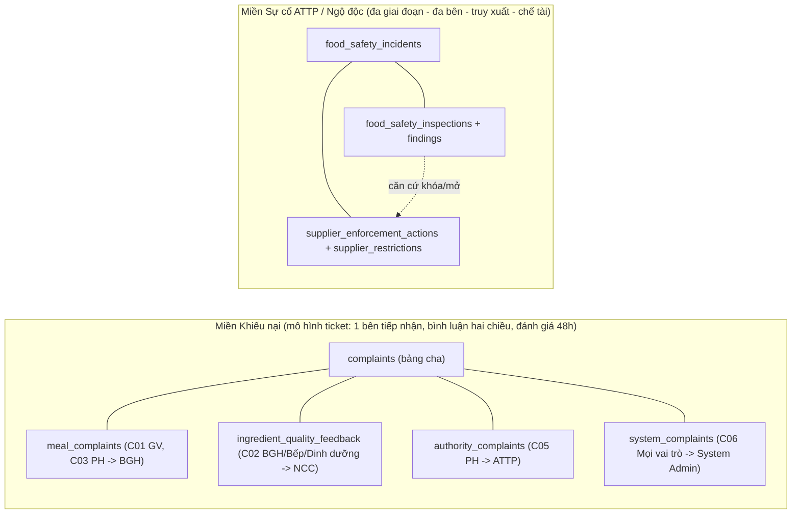
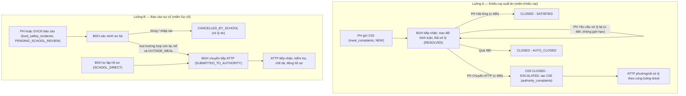
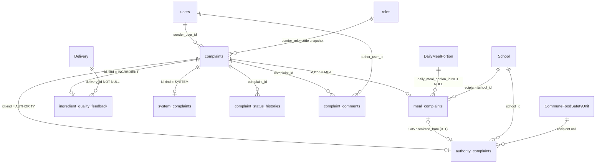
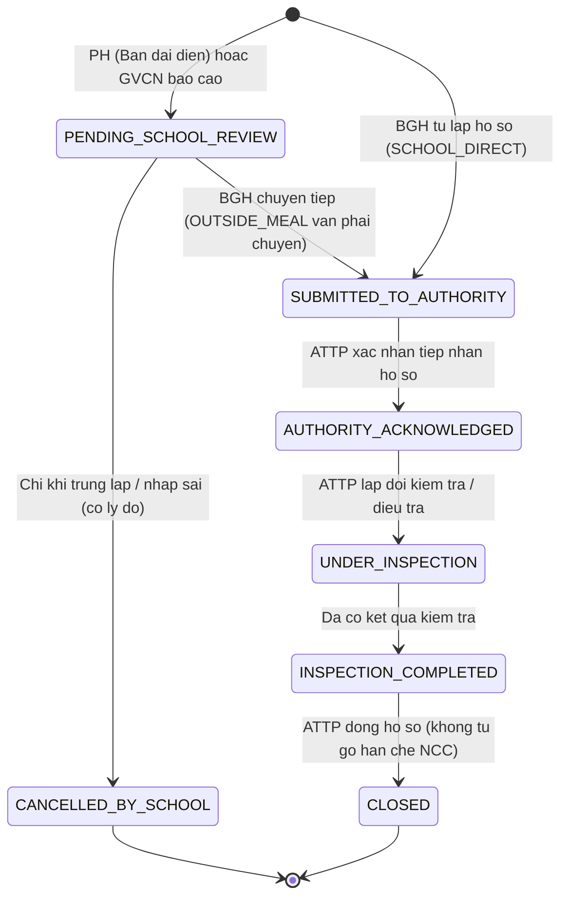
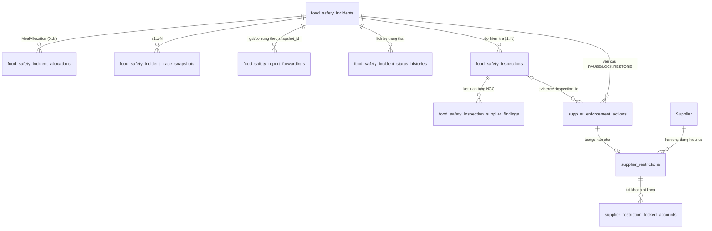

# Kế hoạch thiết kế DB v5 — Khiếu nại (mô hình ticket) & Sự cố ATTP (chưa sửa code)

> [!NOTE]
> Bản v5 chuyển miền Khiếu nại sang **mô hình ticket** (tham chiếu `VOPS-13064-updated.md`, sơ đồ chi tiết ở `complaint_state_diagrams.md`) và khóa kết quả kiểm tra ATTP sau khi ghi. Bản v4 cập nhật v3 cho khớp với quy tắc mã nghiệp vụ Feistel (PR #165, `AGENTS.md` mục "Coding Style & Architecture", `specs/feistel-business-codes/`) và schema hiện tại trên `dev`. Hiện **chưa sửa code, `prisma/schema.prisma`, hay database**.
>
> Các điểm còn **chờ chốt** được đánh dấu `⏳` và gom ở mục 0. Không viết spec/migration cho phần đó trước khi chốt.

---

## 0. Thay đổi so với v3 & quyết định còn chờ chốt

### 0.1 Thay đổi so với v3

| #   | Mục v3                                                                                 | Sửa trong v4                                                                                                                                                                                                                                                            | Lý do                                                                                                                      |
| --- | -------------------------------------------------------------------------------------- | ----------------------------------------------------------------------------------------------------------------------------------------------------------------------------------------------------------------------------------------------------------------------- | -------------------------------------------------------------------------------------------------------------------------- |
| D1  | 3.1 `complaint_code` + sequence `complaint_code_seq`, "không cắt sau 99999"            | Cột `complaints.code`, chữ viết tắt **theo `kind`**, hậu tố Feistel 5 chữ số, cấp qua `business_code_counters` + advisory lock; hết dải → lỗi rõ ràng                                                                                                                   | Trái quy tắc Feistel; `CP` đã đăng ký cho khiếu nại nguyên liệu, `MC` cho khiếu nại bữa ăn, mã đã phát hành không được đổi |
| D2  | 5.2.1 `incident_code` + `incident_code_seq`                                            | Dùng lại cột `food_safety_incidents.code` (`FP-IC-`, Feistel) đã có                                                                                                                                                                                                     | Cột và CHECK định dạng đã tồn tại từ migration `20261123000100_business_code_feistel`                                      |
| D3  | 3.1 `complaint_code NOT NULL`                                                          | Thêm trình tự backfill + guard trước khi siết `NOT NULL` (mục 6.1)                                                                                                                                                                                                      | Khóa Feistel nằm trong cấu hình, SQL migration không tự tính được mã cho đơn cũ                                            |
| D4  | 3.1 enum trạng thái                                                                    | Enum mới `complaint_lifecycle_status` cho bảng cha + bảng ánh xạ dữ liệu cũ (mục 6.2)                                                                                                                                                                                   | `ComplaintStatus` hiện có `RESOLVED`; `IngredientQualityFeedbackStatus` là enum riêng                                      |
| D5  | 5.1 enum sự cố                                                                         | Enum mới `food_safety_incident_status` + ánh xạ `OPEN/INVESTIGATING/RESOLVED/CLOSED` cũ (mục 6.3)                                                                                                                                                                       | `IncidentStatus` hiện chỉ có 4 giá trị, chưa có kế hoạch cho bản ghi cũ                                                    |
| D6  | 3.3.1 bỏ `handled_by_user_id`, `submitted_at`, `resolved_at`                           | Ánh xạ rõ sang bảng cha / version / lịch sử trạng thái (mục 6.2)                                                                                                                                                                                                        | Tránh mất người xử lý của đơn đang `IN_REVIEW`                                                                             |
| D7  | 3.2 FK tổ hợp "nếu muốn"                                                               | ~~Bắt buộc FK tổ hợp `(id, current_response_version_id)`~~ — **không còn áp dụng** (D15)                                                                                                                                                                                | Đã bỏ bảng phiên bản phản hồi                                                                                              |
| D8  | 3.3 transaction `Serializable` cho mọi lần tạo                                         | Transaction thường (ReadCommitted) + advisory lock cấp mã + UNIQUE; `Serializable` chỉ cho duyệt/thực thi chế tài                                                                                                                                                       | Giảm xung đột/retry không cần thiết                                                                                        |
| D9  | 5.2.4 partial unique `supplier_restrictions`                                           | Dùng `NULLS NOT DISTINCT` (hoặc biểu thức `COALESCE`)                                                                                                                                                                                                                   | `incident_id IS NULL` (hạn chế thủ công) sẽ lọt qua unique thường                                                          |
| D10 | 5.2.4 CHECK "hoặc gắn finding `AT_FAULT`"                                              | Tách: CHECK trong bảng + kiểm tra liên bảng ở service                                                                                                                                                                                                                   | CHECK không tham chiếu được bảng khác                                                                                      |
| D11 | Q13 / 5.2.4 khóa tài khoản                                                             | Thêm bảng `supplier_restriction_locked_accounts` + thu hồi session Redis khi khóa                                                                                                                                                                                       | Cần biết chính xác tài khoản nào bị khóa bởi hạn chế nào để `RESTORE` chỉ mở đúng khóa đó                                  |
| D12 | 6 rollback                                                                             | Rollback = migration tiến (forward) mới; ghi rõ tương tác với CD `azure-dev`                                                                                                                                                                                            | Migration đã áp dụng là bất biến; CD tự deploy sau CI                                                                      |
| D13 | PR5/PR6                                                                                | Ghi rõ quyết định với module hiện có `src/modules/inspection`, `src/modules/authority`                                                                                                                                                                                  | Tránh trùng tên/route                                                                                                      |
| D14 | Q3, 2, 5.1, 5.2.1 (`origin_complaint_id`, `FROM_MEAL_COMPLAINT`, `SCHOOL_DIRECT`)      | **Tách hẳn 2 luồng** (Q19): khiếu nại suất ăn và báo cáo sự cố không còn liên kết; bỏ `origin_complaint_id` và nguồn `FROM_MEAL_COMPLAINT`; người báo sự cố là phụ huynh (Ban đại diện), GVCN, hoặc BGH tự lập hồ sơ (Q20); `HEALTH_ISSUE` không nhận cho đơn mới (Q21) | Hai luồng nghiệp vụ khác nhau, v3/v4 đang gộp                                                                              |
| D15 | Q25 cũ "phản hồi một lần" (`response_content`, `responded_*`)                          | **Thay bằng mô hình ticket** (Q25 mới): trạng thái `NEW → IN_PROGRESS → RESOLVED → CLOSED` (+ `REOPENED`), bình luận hai chiều append-only `complaint_comments`, nội dung xử lý lưu thành bình luận `RESOLUTION`, đánh giá trong 48h, job tự đóng 48h, email            | Áp dụng cho mọi loại đơn C01, C02, C03, C05, C06                                                                           |
| D16 | Q6, 5.2.3, 5.2.4 (`food_safety_inspection_versions`, `evidence_inspection_version_id`) | **Kết quả kiểm tra không sửa được** (Q26): bỏ bảng phiên bản; kết quả ghi thẳng một lần trên `food_safety_inspections`; findings và căn cứ chế tài trỏ tới `inspection_id`                                                                                              | Chủ dự án chốt không cho sửa                                                                                               |

### 0.2 Quyết định còn chờ chốt

| Câu        | Nội dung                                                                                                                                                                  | Đề xuất                                                                                                                                                                                                                                              |
| ---------- | ------------------------------------------------------------------------------------------------------------------------------------------------------------------------- | ---------------------------------------------------------------------------------------------------------------------------------------------------------------------------------------------------------------------------------------------------- |
| ✅ **Q14** | Chữ viết tắt mã cho C05 (`AUTHORITY`) và C06 (`SYSTEM`)                                                                                                                   | **Đã chốt**: `AC` (C05) và `SC` (C06)                                                                                                                                                                                                                |
| ✅ **Q15** | Cách siết `complaints.code NOT NULL`                                                                                                                                      | **Đã chốt phương án (a)**: chạy `business-codes:backfill` trên local và `-- --azure` cho `azure-dev` (đã được chủ dự án đồng ý là thao tác vận hành cần làm) trước khi merge PR1; migration PR1 có guard dừng nếu còn `meal_complaints.code IS NULL` |
| ⏳ **Q16** | Ánh xạ `IncidentStatus` cũ sang trạng thái mới                                                                                                                            | Xem bảng đề xuất ở mục 6.3                                                                                                                                                                                                                           |
| ~~Q17~~    | ~~`origin_complaint_id` 0..1 hay 0..N~~                                                                                                                                   | **Không còn áp dụng**: đã bỏ liên kết khiếu nại ↔ sự cố (Q19)                                                                                                                                                                                        |
| ⏳ **Q27** | Migration PR1 khi **chưa có dữ liệu khiếu nại**                                                                                                                           | **Đề xuất**: không viết phần chuyển dữ liệu; migration mở đầu bằng guard dừng nếu `meal_complaints` hoặc `ingredient_quality_feedback` còn dòng nào (mục 6.2)                                                                                        |
| ⏳ **Q28** | Đổi contract API hiện có (`/api/meal-complaints`, `POST /api/ingredient-quality-feedback/:id/response`) theo mô hình ticket — **thay đổi phá vỡ (breaking)** cho frontend | **Đề xuất**: đổi thẳng trong PR1 (chưa có dữ liệu, frontend cập nhật cùng đợt), không giữ lớp ánh xạ tương thích                                                                                                                                     |
| ⏳ **Q18** | PR5/PR6 mở rộng module `inspection`/`authority` hiện có hay tạo module mới                                                                                                | Đọc phạm vi 2 module hiện có trước khi viết spec PR5 rồi chốt                                                                                                                                                                                        |

---

## 1. Bảng các quyết định đã chốt (Q1–Q13)

| Câu                                                | Quyết định đã chốt                                                                                                                                                                                                                                                                                                                                                                                                                                                                                                                                                                                                                                                                                                                                                                                                                                                                                                                                                                                                                    | Tác động chính lên thiết kế                                                                                                                                                                                                                                                                                                                                                                                                                                                                                                                                                                                                                               |
| -------------------------------------------------- | ------------------------------------------------------------------------------------------------------------------------------------------------------------------------------------------------------------------------------------------------------------------------------------------------------------------------------------------------------------------------------------------------------------------------------------------------------------------------------------------------------------------------------------------------------------------------------------------------------------------------------------------------------------------------------------------------------------------------------------------------------------------------------------------------------------------------------------------------------------------------------------------------------------------------------------------------------------------------------------------------------------------------------------- | --------------------------------------------------------------------------------------------------------------------------------------------------------------------------------------------------------------------------------------------------------------------------------------------------------------------------------------------------------------------------------------------------------------------------------------------------------------------------------------------------------------------------------------------------------------------------------------------------------------------------------------------------------- |
| **Q1** (C02)                                       | Người gửi C02 gồm **BGH (`SCHOOL_MANAGEMENT_BOARD`), nhân viên bếp (`SCHOOL_KITCHEN_STAFF`) và nhân viên dinh dưỡng (`SCHOOL_NUTRITION_OFFICER`)**                                                                                                                                                                                                                                                                                                                                                                                                                                                                                                                                                                                                                                                                                                                                                                                                                                                                                    | Giữ một bảng `ingredient_quality_feedback`; kiểm tra quyền `ingredient_quality_feedback.submit` ở 3 vai trò                                                                                                                                                                                                                                                                                                                                                                                                                                                                                                                                               |
| **Q2** (C04)                                       | **Bỏ C04**; BGH gửi vấn đề ATTP lên cán bộ ATTP qua luồng `FoodSafetyIncident`                                                                                                                                                                                                                                                                                                                                                                                                                                                                                                                                                                                                                                                                                                                                                                                                                                                                                                                                                        | `authority_complaints` chỉ phục vụ **C05** (phụ huynh leo thang)                                                                                                                                                                                                                                                                                                                                                                                                                                                                                                                                                                                          |
| **Q3** (`HEALTH_ISSUE`) — _thay thế bởi Q19, Q21_  | ~~Giữ `HEALTH_ISSUE`; BGH tạo `FoodSafetyIncident` liên kết từ đơn khiếu nại~~                                                                                                                                                                                                                                                                                                                                                                                                                                                                                                                                                                                                                                                                                                                                                                                                                                                                                                                                                        | Không còn `origin_complaint_id`; xem Q19/Q21                                                                                                                                                                                                                                                                                                                                                                                                                                                                                                                                                                                                              |
| **Q4** (BGH & sự cố)                               | BGH **phải chuyển** mọi báo cáo sự cố hợp lệ (từ phụ huynh hoặc GVCN) lên ATTP; chỉ được hủy báo cáo trùng/nhập sai kèm lý do, **không** kết thúc hồ sơ vì nhận định `OUTSIDE_MEAL`                                                                                                                                                                                                                                                                                                                                                                                                                                                                                                                                                                                                                                                                                                                                                                                                                                                   | Bỏ trạng thái `DISMISSED_BY_SCHOOL`; đổi `school_conclusion` thành nhận định sơ bộ `school_preliminary_assessment`                                                                                                                                                                                                                                                                                                                                                                                                                                                                                                                                        |
| **Q5** (Đóng Incident & NCC)                       | ATTP đóng Incident khi đủ kết quả/kiểm tra; ATTP đề nghị `PAUSE`/`LOCK`/`RESTORE` có căn cứ; System Admin duyệt và thực thi; đóng hồ sơ không tự gỡ hạn chế; `RESTORE` không vượt hạn chế còn hiệu lực khác                                                                                                                                                                                                                                                                                                                                                                                                                                                                                                                                                                                                                                                                                                                                                                                                                           | Tách 3 trạng thái độc lập (`Incident`, `Inspection`, `EnforcementAction`) + bảng quản lý hiệu lực hạn chế `supplier_restrictions`                                                                                                                                                                                                                                                                                                                                                                                                                                                                                                                         |
| **Q6** (Bất biến) — _thay thế bởi Q25, Q26_        | Bình luận khiếu nại append-only (Q25); kết quả kiểm tra ATTP ghi một lần, không sửa (Q26); snapshot truy xuất luôn tạo phiên bản mới                                                                                                                                                                                                                                                                                                                                                                                                                                                                                                                                                                                                                                                                                                                                                                                                                                                                                                  | Không có bảng phiên bản phản hồi hay phiên bản kết quả kiểm tra                                                                                                                                                                                                                                                                                                                                                                                                                                                                                                                                                                                           |
| **Q7** (C05 cardinality)                           | Mỗi đơn C03 tạo tối đa **0..1** đơn C05, do chính phụ huynh đã gửi C03 bấm "Chuyển ATTP" khi C03 đang `RESOLVED` và **chưa quá 48h** kể từ lần "Đã xử lý" gần nhất                                                                                                                                                                                                                                                                                                                                                                                                                                                                                                                                                                                                                                                                                                                                                                                                                                                                    | UNIQUE trên `escalated_from_meal_complaint_id`; C03 đóng với `close_reason = ESCALATED` trong cùng transaction tạo C05                                                                                                                                                                                                                                                                                                                                                                                                                                                                                                                                    |
| **Q8** (Phạm vi suất ăn)                           | Giữ nguyên Spec 019: gắn `DailyMealPortion` hôm nay theo giờ Việt Nam đã `DISTRIBUTED`/`FINALIZED`; chưa mở khiếu nại chung theo khoảng thời gian                                                                                                                                                                                                                                                                                                                                                                                                                                                                                                                                                                                                                                                                                                                                                                                                                                                                                     | `meal_complaints.daily_meal_portion_id` giữ `NOT NULL`                                                                                                                                                                                                                                                                                                                                                                                                                                                                                                                                                                                                    |
| **Q9** (Trạng thái Complaint) — _thay thế bởi Q25_ | ~~`SUBMITTED → IN_REVIEW → RESPONDED`~~                                                                                                                                                                                                                                                                                                                                                                                                                                                                                                                                                                                                                                                                                                                                                                                                                                                                                                                                                                                               | Xem Q25                                                                                                                                                                                                                                                                                                                                                                                                                                                                                                                                                                                                                                                   |
| **Q10** (Địa bàn ATTP)                             | **1 phường/xã (`Location`) gắn tối đa 1 `CommuneFoodSafetyUnit`** (`location_id UNIQUE`); trường bắt buộc có `location_id` cấp phường/xã để tự suy ra đơn vị ATTP nhận; hồ sơ đã gửi giữ đơn vị nhận lịch sử                                                                                                                                                                                                                                                                                                                                                                                                                                                                                                                                                                                                                                                                                                                                                                                                                          | Thêm `commune_food_safety_units.location_id`; không để người gửi tự chọn đơn vị nhận                                                                                                                                                                                                                                                                                                                                                                                                                                                                                                                                                                      |
| **Q11** (Quyền xem)                                | C02: BGH xem toàn trường, bếp/dinh dưỡng xem đơn mình gửi. Kết quả kiểm tra chỉ ATTP phụ trách ghi (một lần, Q26)                                                                                                                                                                                                                                                                                                                                                                                                                                                                                                                                                                                                                                                                                                                                                                                                                                                                                                                     | Kiểm tra lại quyền và phạm vi tổ chức trong transaction ở mọi thao tác ghi                                                                                                                                                                                                                                                                                                                                                                                                                                                                                                                                                                                |
| **Q12** (Thứ tự PR)                                | Thực hiện theo thứ tự: **PR1 (Complaint supertype) → PR2 (C06) → PR3 (C02) → PR4 (C05) → PR5 (Incident) → PR6 (Inspection & Enforcement)**                                                                                                                                                                                                                                                                                                                                                                                                                                                                                                                                                                                                                                                                                                                                                                                                                                                                                            | PR1 đi trước kèm migration rehearsal, kế hoạch rollback và cửa sổ ngừng ghi                                                                                                                                                                                                                                                                                                                                                                                                                                                                                                                                                                               |
| **Q13** (`LOCK_ACCOUNT`)                           | `LOCK_ACCOUNT` = **khóa tạm (`AccountStatus.LOCKED`)** admin và nhân viên NCC; `RESTORE` mở lại được đúng khóa do sự cố nếu không còn hạn chế khác (bổ sung luồng khóa/mở có lịch sử, tách biệt với `DEACTIVATED` vĩnh viễn)                                                                                                                                                                                                                                                                                                                                                                                                                                                                                                                                                                                                                                                                                                                                                                                                          | Mở rộng `account-lifecycle` hỗ trợ `LOCKED` ↔ `ACTIVE` cho sự cố ATTP, có audit lịch sử và bảng liên kết tài khoản bị khóa (mục 5.2.4)                                                                                                                                                                                                                                                                                                                                                                                                                                                                                                                    |
| **Q19** (Tách 2 luồng)                             | **Luồng A — Khiếu nại suất ăn**: phụ huynh gửi C03 → BGH phản hồi → nếu không hài lòng, phụ huynh **tự leo thang thẳng** lên ATTP (C05). **Luồng B — Báo cáo sự cố**: phụ huynh/GVCN báo cáo → BGH xác minh sơ bộ → BGH chuyển tiếp lên ATTP. Hai luồng **không liên kết** dữ liệu, không luồng nào tự sinh bản ghi của luồng kia                                                                                                                                                                                                                                                                                                                                                                                                                                                                                                                                                                                                                                                                                                     | Bỏ `origin_complaint_id`, bỏ nguồn `FROM_MEAL_COMPLAINT`; C05 thuộc miền Khiếu nại, báo cáo sự cố thuộc miền Sự cố                                                                                                                                                                                                                                                                                                                                                                                                                                                                                                                                        |
| **Q20** (Người báo sự cố)                          | **Phụ huynh (`PARENTS_COMMITTEE`)** và **GVCN** gửi báo cáo sự cố lên BGH; **BGH được tự lập hồ sơ và gửi thẳng ATTP**                                                                                                                                                                                                                                                                                                                                                                                                                                                                                                                                                                                                                                                                                                                                                                                                                                                                                                                | `source` ∈ {`PARENT_REPORT`, `TEACHER_REPORT`, `SCHOOL_DIRECT`} (+ `LEGACY_IMPORT` cho dữ liệu cũ). Báo cáo của PH/GVCN bắt đầu ở `PENDING_SCHOOL_REVIEW`; hồ sơ BGH tự lập vào thẳng `SUBMITTED_TO_AUTHORITY`, **bỏ qua bước xác minh** (đã xác nhận; BGH ghi nhận định sơ bộ ngay lúc lập)                                                                                                                                                                                                                                                                                                                                                              |
| **Q21** (`HEALTH_ISSUE`)                           | **Không nhận** `HEALTH_ISSUE` cho đơn khiếu nại suất ăn mới; vấn đề sức khỏe đi qua luồng báo cáo sự cố. Dữ liệu cũ giữ nguyên để đọc                                                                                                                                                                                                                                                                                                                                                                                                                                                                                                                                                                                                                                                                                                                                                                                                                                                                                                 | Giữ giá trị enum `MealComplaintType.HEALTH_ISSUE` trong DB cho dòng cũ; validation tạo mới loại bỏ giá trị này (amend Spec 019)                                                                                                                                                                                                                                                                                                                                                                                                                                                                                                                           |
| **Q22** (BGH xem C05)                              | BGH của trường **chỉ được xem** (read-only) các đơn C05 leo thang từ trường mình, gồm nội dung đơn, **toàn bộ bình luận PH ↔ ATTP** và lịch sử trạng thái; **không** bình luận, tiếp nhận hay đổi trạng thái C05                                                                                                                                                                                                                                                                                                                                                                                                                                                                                                                                                                                                                                                                                                                                                                                                                      | Scope đọc của BGH lọc theo `authority_complaints.school_id = principal.schoolId` trong repository; chỉ ATTP phụ trách (`recipient_commune_food_safety_unit_id`) xử lý; mã quyền xem chốt trong spec PR4                                                                                                                                                                                                                                                                                                                                                                                                                                                   |
| **Q23** (Người báo theo dõi sự cố)                 | Với báo cáo do **phụ huynh hoặc GVCN** gửi: chính người báo được xem tiến độ hồ sơ (các trạng thái tới `CLOSED`/`CANCELLED_BY_SCHOOL`, kèm lý do hủy) **và kết luận kiểm tra của ATTP**. Với hồ sơ **BGH tự lập** (`SCHOOL_DIRECT`): GVCN và phụ huynh **không** xem được                                                                                                                                                                                                                                                                                                                                                                                                                                                                                                                                                                                                                                                                                                                                                             | Scope đọc của người báo: `reported_by_user_id = principal.userId AND source IN ('PARENT_REPORT','TEACHER_REPORT')` trong repository; chỉ đọc, không sửa sau khi gửi. Projection cho người báo gồm trạng thái, mốc thời gian, lý do hủy và **toàn bộ kết luận kiểm tra của ATTP**: mọi đợt kiểm tra, `result_summary`, `overall_conclusion`, kết luận theo từng NCC (`food_safety_inspection_supplier_findings`: NCC, `finding`, `evidence_note`). **Không** gồm yêu cầu/quyết định chế tài NCC và snapshot truy xuất (không thuộc phần kết luận); thông tin định danh người dùng nội bộ (người ghi kết quả) chỉ hiển thị tên/vai trò theo safe projection |
| **Q24** (`SCHOOL_ADMINISTRATION`)                  | Vai trò `SCHOOL_ADMINISTRATION` **nằm ngoài phạm vi** toàn bộ luồng khiếu nại và sự cố (không gửi, không xem, không xử lý)                                                                                                                                                                                                                                                                                                                                                                                                                                                                                                                                                                                                                                                                                                                                                                                                                                                                                                            | Không cấp quyền khiếu nại/sự cố cho vai trò này trong catalog; scope helper không mở cho vai trò này                                                                                                                                                                                                                                                                                                                                                                                                                                                                                                                                                      |
| **Q25** (Mô hình ticket)                           | Mọi đơn khiếu nại (C01, C02, C03, C05, C06) dùng chung luồng ticket:<br>- **Hai lớp trạng thái**: bên xử lý thấy `Đơn mới / Đang xử lý (+ nhãn Có tin nhắn mới) / Yêu cầu xử lý lại / Đã xử lý / Đã đóng`; người gửi chỉ thấy `Đang xử lý / Đã xử lý / Đã đóng`<br>- Bên xử lý **chỉ "Tiếp nhận"**, không có "Từ chối"<br>- **Bình luận hai chiều**, không sửa/xóa, không có bình luận nội bộ; người gửi bình luận ở `NEW`/`IN_PROGRESS`/`REOPENED`; bên xử lý phải Tiếp nhận trước mới bình luận (chỉ ở `IN_PROGRESS`)<br>- "Đã xử lý" bắt buộc kèm nội dung xử lý<br>- Trong **48h** kể từ lần "Đã xử lý" gần nhất người gửi chọn: **Hài lòng** (đóng ngay), **Yêu cầu xử lý lại** (**không giới hạn** số lần), **Chuyển ATTP** (chỉ C03); **không** có nút "Không hài lòng"; lý do **không bắt buộc**<br>- Quá 48h không thao tác → **job tự đóng**<br>- **Chỉ email** (không in-app) cho người gửi khi tạo đơn, khi bên xử lý bình luận, khi chuyển "Đã xử lý"; không gửi khi đóng<br>- Tiêu đề do hệ thống tự sinh theo loại đơn | Mục 3.1–3.2; sơ đồ ở `complaint_state_diagrams.md`                                                                                                                                                                                                                                                                                                                                                                                                                                                                                                                                                                                                        |
| **Q26** (Kết quả kiểm tra bất biến)                | Kết quả kiểm tra của ATTP (tóm tắt, kết luận chung, kết luận từng NCC) **ghi một lần, không sửa**                                                                                                                                                                                                                                                                                                                                                                                                                                                                                                                                                                                                                                                                                                                                                                                                                                                                                                                                     | Bỏ `food_safety_inspection_versions`; mục 5.2.3                                                                                                                                                                                                                                                                                                                                                                                                                                                                                                                                                                                                           |

---

## 2. Kiến trúc tổng thể: Tách 2 miền nghiệp vụ



Hai miền **không có FK nối với nhau** (Q19). Hai luồng phụ huynh đi như sau:



Khác biệt chính: ở luồng A, **phụ huynh** quyết định leo thang, chỉ khi BGH đã "Đã xử lý" và trong 48h; ở luồng B, **BGH** là bên chuyển tiếp và bắt buộc chuyển trừ khi trùng/nhập sai (Q4); BGH cũng có thể tự lập hồ sơ gửi thẳng ATTP (Q20).

---

## 3. Thiết kế chi tiết Miền Khiếu nại



### 3.1 Bảng cha `complaints`

- `id` (`uuid PK`): giữ nguyên UUID hiện có của `meal_complaints` và `ingredient_quality_feedback` khi migrate để không vỡ đường dẫn API hiện tại.
- `kind` (`enum complaint_kind`: `MEAL | INGREDIENT | AUTHORITY | SYSTEM`), kèm `UNIQUE(id, kind)`.
- **Mã nghiệp vụ `code`** (`varchar(25) UNIQUE NOT NULL`, theo trình tự ở mục 6.1 — Q15):
  - Chữ viết tắt **cố định theo `kind`**, mỗi chữ viết tắt đăng ký một lần trong `src/utils/business-code.ts`:

    | `kind`       | Chữ viết tắt | Trạng thái                                                                      |
    | ------------ | ------------ | ------------------------------------------------------------------------------- |
    | `MEAL`       | `MC`         | Đã đăng ký, mã `FP-MC-` đã phát hành → chuyển nguyên giá trị lên bảng cha       |
    | `INGREDIENT` | `CP`         | Đã đăng ký, gồm cả mã cũ tuần tự (`LEGACY_PATTERNS.CP`) → chuyển nguyên giá trị |
    | `AUTHORITY`  | `AC` (Q14)   | Đăng ký mới ở PR4                                                               |
    | `SYSTEM`     | `SC` (Q14)   | Đăng ký mới ở PR2                                                               |

  - Mã mới: `FP-<XX>-<NNNNN>`, `NNNNN = pad5(feistelEncrypt(sequence − 1, BUSINESS_CODE_KEY))`; `sequence` lấy từ `business_code_counters` theo `code_type` trong cùng transaction tạo đơn, dưới advisory lock theo loại. Hết dải 100.000 mã của một loại ⇒ báo lỗi rõ ràng, **không** quay vòng hay nới định dạng. **Không** dùng sequence PostgreSQL riêng.
  - Mã đã cấp không bao giờ đổi hay tái sử dụng; vì prefix khác nhau theo loại nên UNIQUE một cột ở bảng cha đảm bảo duy nhất toàn hệ thống.
  - SQL CHECK định dạng: chấp nhận `^FP-[A-Z]{2}-[0-9]{5}$` **và** định dạng cũ của `CP` (`^FP-CP-([0-9]{5}|[1-9][0-9]{5,18})$`); thêm CHECK chữ viết tắt khớp `kind` (vd. `kind = 'MEAL' ⇒ code LIKE 'FP-MC-%'`).
- **Thông tin người gửi (snapshot lịch sử tại lúc gửi)**:
  - `sender_user_id` (`uuid FK -> users NOT NULL`)
  - `sender_role_code` (`varchar(60) FK -> roles(code) NOT NULL`) — phục vụ lịch sử và hiển thị; **không** dùng thay cho quyền hiệu lực hiện hành khi xử lý.
  - `sender_school_id`, `sender_supplier_id`, `sender_commune_food_safety_unit_id` (nullable FK, SQL CHECK `num_nonnulls(...) <= 1`; `= 0` chỉ hợp lệ với vai trò hệ thống — kiểm tra ở service vì CHECK không đọc được bảng `roles`).
- **Nội dung**: `title` (`varchar(255) NOT NULL`, **hệ thống tự sinh** theo loại đơn — danh sách chuỗi tiếng Việt chốt trong spec PR1), `description` (`text NOT NULL`).
- **Trạng thái ticket (Q25)**:
  - `status` (enum **mới** `complaint_ticket_status`: `NEW | IN_PROGRESS | REOPENED | RESOLVED | CLOSED`). Enum cũ `complaint_status` và `ingredient_quality_feedback_status` gỡ trong cùng migration.
  - Hai lớp hiển thị tính ở service (không lưu):

    | `status`      | Bên xử lý thấy                                                              | Người gửi thấy |
    | ------------- | --------------------------------------------------------------------------- | -------------- |
    | `NEW`         | Đơn mới                                                                     | Đang xử lý     |
    | `IN_PROGRESS` | Đang xử lý (+ nhãn **Có tin nhắn mới** khi bình luận cuối là của người gửi) | Đang xử lý     |
    | `REOPENED`    | Yêu cầu xử lý lại                                                           | Đang xử lý     |
    | `RESOLVED`    | Đã xử lý                                                                    | Đã xử lý       |
    | `CLOSED`      | Đã đóng (kèm lý do)                                                         | Đã đóng        |

  - `last_resolved_at` (`timestamptz NULL`): thời điểm "Đã xử lý" gần nhất — mốc 48h cho mọi thao tác của người gửi và cho job tự đóng. CHECK `status <> 'RESOLVED' OR last_resolved_at IS NOT NULL`.
  - `resolved_count` (`int NOT NULL DEFAULT 0`, CHECK `>= 0`): số lần "Đã xử lý", chỉ để hiển thị/thống kê (không giới hạn mở lại).
  - `close_reason` (enum `complaint_close_reason`: `SATISFIED | ESCALATED | AUTO_CLOSED`), `closed_at`, `closed_by_user_id` (`NULL` khi `AUTO_CLOSED`). CHECK: `(status = 'CLOSED') = (close_reason IS NOT NULL AND closed_at IS NOT NULL)`; `close_reason = 'AUTO_CLOSED' ⇔ closed_by_user_id IS NULL` (khi đã đóng); `close_reason = 'ESCALATED' ⇒ kind = 'MEAL'`.
- **Chuyển trạng thái (service kiểm tra, repository ghi bằng cập nhật có điều kiện)**:

  | Hành động         | Ai                  | Từ → Đến                            | Điều kiện / tác dụng phụ                                                                                |
  | ----------------- | ------------------- | ----------------------------------- | ------------------------------------------------------------------------------------------------------- |
  | Tạo đơn           | Người gửi           | — → `NEW`                           | Cấp mã, tạo tiêu đề, ghi lịch sử, email "đã ghi nhận"                                                   |
  | Tiếp nhận         | Bên xử lý           | `NEW` / `REOPENED` → `IN_PROGRESS`  |                                                                                                         |
  | Bình luận         | Người gửi           | giữ nguyên                          | Chỉ ở `NEW`, `IN_PROGRESS`, `REOPENED`                                                                  |
  | Bình luận         | Bên xử lý           | giữ nguyên                          | Chỉ ở `IN_PROGRESS`; email cho người gửi                                                                |
  | Đã xử lý          | Bên xử lý           | `IN_PROGRESS` → `RESOLVED`          | Bắt buộc nội dung (lưu bình luận `RESOLUTION`); `last_resolved_at = now()`, `resolved_count + 1`; email |
  | Hài lòng          | Người gửi           | `RESOLVED` → `CLOSED (SATISFIED)`   | `now() < last_resolved_at + 48h`                                                                        |
  | Yêu cầu xử lý lại | Người gửi           | `RESOLVED` → `REOPENED`             | `now() < last_resolved_at + 48h`; không giới hạn số lần; lý do tùy chọn (lưu bình luận `REOPEN_NOTE`)   |
  | Chuyển ATTP       | Người gửi (chỉ C03) | `RESOLVED` → `CLOSED (ESCALATED)`   | `now() < last_resolved_at + 48h`; tạo C05 cùng transaction; lý do tùy chọn                              |
  | Tự đóng           | Hệ thống (job)      | `RESOLVED` → `CLOSED (AUTO_CLOSED)` | `now() >= last_resolved_at + 48h`; không gửi email                                                      |
  - Mọi cập nhật trạng thái dùng `updateMany` có điều kiện trên `status` (và `last_resolved_at` cho thao tác 48h); 0 dòng ⇒ `409`. Thao tác của người gửi quá 48h bị từ chối `409` kể cả khi job chưa kịp chạy.

- `submitted_at` (`timestamptz NOT NULL DEFAULT now()`), `updated_at` (`@updatedAt`). Giữ tên `submitted_at` để khớp cột hiện có của `meal_complaints`; `ingredient_quality_feedback.created_at` ánh xạ vào đây.
- Index: `(kind, submitted_at DESC, id)`, `(sender_user_id, submitted_at DESC)`, `(status, submitted_at DESC)`, partial `(last_resolved_at) WHERE status = 'RESOLVED'` cho job tự đóng.

### 3.2 Bình luận, lịch sử trạng thái, job tự đóng, email

1. **`complaint_comments`** (append-only, không sửa/xóa, không có bình luận nội bộ):
   - `id` (`uuid PK`), `complaint_id` (`FK -> complaints NOT NULL`), `author_user_id` (`FK -> users NOT NULL`), `author_role_code` (`FK -> roles(code) NOT NULL`), `author_side` (`REQUESTER | HANDLER`), `comment_type` (`MESSAGE | RESOLUTION | REOPEN_NOTE | ESCALATION_NOTE`), `content` (`text NOT NULL`, CHECK `length(btrim(content)) > 0`), `created_at`.
   - CHECK: `comment_type = 'RESOLUTION' ⇒ author_side = 'HANDLER'`; `comment_type IN ('REOPEN_NOTE','ESCALATION_NOTE') ⇒ author_side = 'REQUESTER'`.
   - Index `(complaint_id, created_at, id)`.
   - Nhãn "Có tin nhắn mới" = bình luận mới nhất của đơn có `author_side = 'REQUESTER'` (repository trả kèm khi liệt kê).
2. **`complaint_status_histories`** (append-only):
   - `id`, `complaint_id`, `from_status` (`NULL` khi tạo), `to_status`, `close_reason` (`NULL` trừ khi đóng), `actor_type` (`USER | SYSTEM`), `actor_user_id` (`NULL` ⇔ `actor_type = 'SYSTEM'`), `actor_role_code`, `created_at`.
3. Bất biến: service/repository chỉ `CREATE` trên 2 bảng này; khuyến nghị thu hồi `UPDATE`/`DELETE` của user runtime nếu chính sách DB cho phép.
4. **Job tự đóng 48h**: BullMQ repeatable job (chạy cùng process API như email outbox, `src/utils/email-runtime.ts`), mỗi 5 phút quét theo lô `status = 'RESOLVED' AND last_resolved_at <= now() - interval '48 hours'`, mỗi đơn đóng bằng `updateMany` có điều kiện + ghi lịch sử `actor_type = 'SYSTEM'` trong một transaction. Idempotent; đơn vừa được người gửi thao tác sẽ không khớp điều kiện nên bị bỏ qua.
5. **Email** (chỉ email, gửi cho người gửi qua email outbox hiện có, **sau commit**): tạo đơn, bình luận mới của bên xử lý, chuyển "Đã xử lý". Không gửi khi đóng (mọi lý do). Mẫu nội dung chốt trong spec PR email.

### 3.3 Bốn bảng con (Class-Table Inheritance dùng FK tổ hợp)

Mỗi bảng con có:

```sql
kind complaint_kind NOT NULL DEFAULT '<KIND>' CHECK (kind = '<KIND>'),
FOREIGN KEY (id, kind) REFERENCES foodprint.complaints(id, kind) ON DELETE RESTRICT
```

- Service tạo bản ghi cha + bản ghi con trong **cùng một transaction** (`prisma.$transaction`, mức cô lập mặc định ReadCommitted); việc cấp mã đã tuần tự hóa bằng advisory lock, các ràng buộc cardinality do UNIQUE đảm bảo. Không cần `Serializable` ở miền Khiếu nại.
- DB không tự chặn được "cha không có con": bổ sung test integration + truy vấn kiểm tra trong migration rehearsal (đếm `complaints` không có bảng con tương ứng = 0).

1. **`meal_complaints` (`MEAL`, C01 + C03)**:
   - Giữ `daily_meal_portion_id` (`NOT NULL`), `complaint_type` (`MealComplaintType`). Đơn mới chỉ nhận `MEAL_QUALITY`, `FOOD_HYGIENE`, `OTHER` (Q21, kiểm tra ở `feedback.validation.ts`); giá trị `HEALTH_ISSUE` giữ trong enum DB chỉ để đọc dòng cũ. Có thể thêm CHECK `NOT VALID` chặn `HEALTH_ISSUE` cho dòng mới — chốt trong spec PR1.
   - Bổ sung `school_id` (`FK -> schools NOT NULL`, lấy qua `DailyMealPortion -> Class -> school_id` lúc tạo) để scope BGH rõ ràng và giữ lịch sử khi người gửi đổi trường.
   - Dời lên bảng cha / bảng phụ rồi bỏ: `code`, `submitted_by_user_id`, `status`, `handled_by_user_id`, `resolution`, `submitted_at`, `resolved_at`, `updated_at`.
   - API `/api/meal-complaints` đổi theo mô hình ticket (⏳ Q28): action `START_REVIEW` → "Tiếp nhận", `RESOLVE` → "Đã xử lý" (chỉ từ `IN_PROGRESS`), thêm bình luận, Hài lòng, Yêu cầu xử lý lại, Chuyển ATTP (C03).
2. **`ingredient_quality_feedback` (`INGREDIENT`, C02)**:
   - Giữ `delivery_id` (`NOT NULL`), `ingredient_lot_id` (`NULL`). Bên nhận suy ra từ `Delivery.supplierId`.
   - Dời lên bảng cha / bình luận rồi bỏ: `complaint_code` (→ `complaints.code`), `submitted_by_user_id`, `title`, `description`, `status`, `supplier_response` (→ bình luận `RESOLUTION`), `responded_by_user_id`, `responded_at`, `created_at`, `updated_at`.
   - API Spec `supplier-complaint-response` (`POST /api/ingredient-quality-feedback/:feedbackId/response`) đổi theo mô hình ticket (⏳ Q28): NCC phải "Tiếp nhận" trước, "Đã xử lý" kèm nội dung; NCC xử lý lại được khi đơn bị mở lại.
3. **`authority_complaints` (`AUTHORITY`, chỉ C05)**:
   - `school_id` (`FK -> schools NOT NULL`)
   - `recipient_commune_food_safety_unit_id` (`FK -> commune_food_safety_units NOT NULL`) — suy ra từ `School.locationId` lúc tạo và lưu cứng làm lịch sử.
   - `escalated_from_meal_complaint_id` (`uuid NOT NULL FK -> meal_complaints(id)`), `UNIQUE (escalated_from_meal_complaint_id)` → mỗi đơn gốc tối đa `0..1` đơn leo thang.
   - **Quyền xem/xử lý (Q22)**: phụ huynh gửi đơn xem/bình luận/đánh giá đơn của mình; ATTP phụ trách tiếp nhận, bình luận, "Đã xử lý"; BGH cùng `school_id` **chỉ xem** (danh sách, chi tiết, bình luận, lịch sử), mọi thao tác ghi của BGH trên C05 trả `403`.
   - Service kiểm tra trong transaction: đơn gốc thuộc đúng `sender_user_id` hiện tại (vai trò `PARENTS_COMMITTEE`), cùng `school_id`, đơn gốc `status = 'RESOLVED'` và chưa quá 48h; đóng đơn gốc `ESCALATED` và tạo C05 (`NEW`) trong cùng transaction. Hai lần chuyển đồng thời bị chặn bởi cập nhật có điều kiện + UNIQUE → `409`. Nội dung C05 = mô tả đơn gốc + lý do chuyển (nếu có).
4. **`system_complaints` (`SYSTEM`, C06)**:
   - Chứa `id`, `kind = 'SYSTEM'`, `PRIMARY KEY (id)`, `FOREIGN KEY (id, kind)`. Mọi thuộc tính chung nằm ở `complaints`; giữ bảng con để mở rộng sau và tách biệt phạm vi truy vấn.

---

## 4. Ánh xạ địa bàn Phường/Xã ↔ Đơn vị ATTP (Q10 + bổ sung)

- Thêm `location_id` (`uuid NULL` ban đầu để tương thích dữ liệu cũ, hướng tới `NOT NULL` sau khi chuẩn hóa) vào `commune_food_safety_units` với `FOREIGN KEY (location_id) REFERENCES locations(id)` và **unique index** `uq_commune_food_safety_units_location_id` trên `(location_id) WHERE location_id IS NOT NULL`.
- Bảo đảm `location_id` là cấp phường/xã: `Location` không có CHECK theo cấp liên bảng → service kiểm tra `Location.level`/`type` khi gắn (giá trị cấp phường/xã cụ thể chốt trong spec PR4 sau khi đối chiếu dữ liệu `locations`).
- Khi System Admin tạo đơn vị/tài khoản `COMMUNE_FOOD_SAFETY_OFFICER`, gắn `location_id` cấp phường/xã cho `CommuneFoodSafetyUnit`.
- Trường (`schools.location_id`) dùng đúng `Location` cấp phường/xã. Khi phát sinh C05 hoặc chuyển `FoodSafetyIncident` lên ATTP, service tra `CommuneFoodSafetyUnit` có `location_id = school.location_id` và `status = 'ACTIVE'`:
  - Nếu trường chưa gắn `location_id` hoặc phường/xã chưa có đơn vị ATTP hoạt động ⇒ trả lỗi nghiệp vụ rõ ràng (`409`/`422`), không để người gửi tự chọn tay.
  - Hồ sơ/đơn đã tạo **lưu cứng** `recipient_commune_food_safety_unit_id`, không tự chuyển nơi nhận nếu sau này đổi địa bàn.

---

## 5. Thiết kế chi tiết Miền Sự cố ATTP / Ngộ độc

### 5.1 Tách 3 tiến trình trạng thái độc lập

| Thành phần                                                                                              | Enum trạng thái                                                                                                                                                                                                                            | Trách nhiệm                                                                                |
| ------------------------------------------------------------------------------------------------------- | ------------------------------------------------------------------------------------------------------------------------------------------------------------------------------------------------------------------------------------------ | ------------------------------------------------------------------------------------------ |
| `food_safety_incidents.status`                                                                          | Enum **mới** `food_safety_incident_status`: `PENDING_SCHOOL_REVIEW` → `SUBMITTED_TO_AUTHORITY` → `AUTHORITY_ACKNOWLEDGED` → `UNDER_INSPECTION` → `INSPECTION_COMPLETED` → `CLOSED` (và nhánh `CANCELLED_BY_SCHOOL` chỉ cho trùng/nhập sai) | Tiến độ tổng thể hồ sơ sự cố. Enum cũ `incident_status` giữ tới khi migrate xong (mục 6.3) |
| `food_safety_inspections.status`                                                                        | `PLANNED` → `COMPLETED`                                                                                                                                                                                                                    | Tiến độ từng đợt kiểm tra (có thể song song với yêu cầu tạm dừng NCC)                      |
| `supplier_enforcement_actions.decision_status` + `execution_status` + `supplier_restrictions.is_active` | Quyết định: `PENDING \| APPROVED \| REJECTED`; Thực thi: `NOT_APPLIED \| APPLIED \| FAILED`                                                                                                                                                | Yêu cầu chế tài, kết quả áp dụng vào `account-lifecycle` và hiệu lực thực tế trên NCC      |



Quy tắc chuyển trạng thái quan trọng:

- **2.1**: BGH ghi `school_preliminary_assessment` ∈ {`SCHOOL_MEAL_SUSPECTED`, `OUTSIDE_MEAL`, `UNDETERMINED`} + `school_preliminary_note`. Giá trị `OUTSIDE_MEAL` **không** mở nhánh đóng hồ sơ; BGH vẫn phải chuyển lên ATTP. Chỉ được `CANCELLED_BY_SCHOOL` khi `cancellation_reason` ∈ {`DUPLICATE_REPORT`, `DATA_ENTRY_ERROR`} kèm `cancellation_note` (CHECK: `status = 'CANCELLED_BY_SCHOOL' ⇔ cancellation_reason IS NOT NULL`).
- **2.2**: Chuyển sang `SUBMITTED_TO_AUTHORITY` **không bắt buộc** có sẵn `food_safety_incident_allocations`. Nếu chưa có, hệ thống ghi `trace_completeness = 'MISSING'` (hoặc `'PARTIAL'` / `'COMPLETE'`), tạo snapshot v1 ghi nhận trạng thái thiếu. Khi bếp/BGH bổ sung allocation sau đó, tạo snapshot v2+ và gửi bản bổ sung lên ATTP (giữ nguyên snapshot v1).
- **Đóng hồ sơ**: ATTP chỉ được chuyển `CLOSED` khi mọi đợt kiểm tra đã `COMPLETED` và có ít nhất 1 kết quả kiểm tra hoàn tất (kiểm tra ở service trong transaction); thao tác đóng **không tự gỡ** bất kỳ hạn chế nào trên NCC.
- Mọi chuyển trạng thái ghi `food_safety_incident_status_histories` (cùng mẫu với `complaint_status_histories`).

### 5.2 Schema các bảng Miền Sự cố



1. **`food_safety_incidents` (mở rộng bảng hiện có)**:
   - **`code`**: dùng lại cột hiện có (`varchar(20) UNIQUE`, `FP-IC-NNNNN` Feistel, CHECK `food_safety_incidents_code_format`). Không thêm cột/sequence mới. Siết `NOT NULL` sau khi `business-codes:backfill` xong (cùng cách với Q15).
   - Giữ `school_id`, `reported_by_user_id`, `title`, `description`, `occurred_at`. `resolved_at` cũ được giữ làm dữ liệu lịch sử (chỉ đọc) hoặc chuyển vào lịch sử trạng thái — chốt cùng Q16.
   - `source` (`PARENT_REPORT` | `TEACHER_REPORT` | `SCHOOL_DIRECT` | `LEGACY_IMPORT`). **Không** có `origin_complaint_id` — sự cố không tham chiếu đơn khiếu nại (Q19).
   - `reported_role_code` (`varchar(60) NULL FK -> roles(code)`; `NULL` chỉ cho `LEGACY_IMPORT`); service kiểm tra `PARENT_REPORT ⇒ PARENTS_COMMITTEE`, `TEACHER_REPORT ⇒` vai trò GVCN, `SCHOOL_DIRECT ⇒ SCHOOL_MANAGEMENT_BOARD`, người báo thuộc đúng `school_id` (Q20). Mã quyền gửi báo cáo sự cố chốt trong spec PR5.
   - `reported_class_id` (`uuid NULL FK -> classes`): bắt buộc với `TEACHER_REPORT` (lớp GVCN phụ trách); tùy chọn với `PARENT_REPORT` và `SCHOOL_DIRECT`.
   - Với `SCHOOL_DIRECT`: `school_preliminary_assessment`, `school_reviewed_by_user_id`, `school_reviewed_at` và `recipient_commune_food_safety_unit_id` được ghi ngay lúc tạo, cùng snapshot truy xuất v1 (quy tắc 2.2 áp dụng như khi chuyển tiếp).
   - `reported_symptomatic_count` (`int NULL`, CHECK `>= 1` khi khác `NULL`; bắt buộc `NOT NULL` với `source <> 'LEGACY_IMPORT'`).
   - **Bỏ** `potential_exposed_portion_count` khỏi bảng (số dẫn xuất dễ lệch khi allocation thay đổi): tính từ tổng `DailyMealPortion.totalPortions` trên tập **khử trùng** `MealAllocation` và lưu trong `payload` của từng snapshot.
   - `symptom_description` (`text`).
   - `school_preliminary_assessment` (`SCHOOL_MEAL_SUSPECTED | OUTSIDE_MEAL | UNDETERMINED`), `school_preliminary_note`, `school_reviewed_by_user_id`, `school_reviewed_at`.
   - `cancellation_reason` (`DUPLICATE_REPORT | DATA_ENTRY_ERROR`, `NULL`), `cancellation_note`.
   - `recipient_commune_food_safety_unit_id` (`uuid NULL FK`; CHECK: `NULL` khi `PENDING_SCHOOL_REVIEW`/`CANCELLED_BY_SCHOOL`, `NOT NULL` từ `SUBMITTED_TO_AUTHORITY` trở đi).
   - `trace_completeness` (`COMPLETE | PARTIAL | MISSING`, `NULL` trước khi gửi ATTP).
   - `status` chuyển sang enum mới (mục 6.3).

2. **`food_safety_incident_trace_snapshots` (bất biến)**:
   - `id`, `incident_id`, `version` (`int`, `UNIQUE(incident_id, version)`, `UNIQUE(incident_id, id)`).
   - `completeness` (`COMPLETE | PARTIAL | MISSING`), `missing_reasons` (`jsonb`).
   - `payload` (`jsonb`): dữ liệu chuẩn hóa kiểu nguyên thủy (Date UTC ISO, Decimal `toFixed(3)`, các mảng `allocations`, `cookingBatches`, `ingredientLots`, `suppliers`, `sourceFacilities`, `retainedSamples` đều sắp xếp cố định theo ID), kèm `potentialExposedPortionCount`.
   - `payload_version` (`int DEFAULT 1`), `hash_algorithm` (`'KECCAK-256'`), `payload_hash` (`varchar(128)` tính từ `canonicalizeJson(payload)`).
   - `created_by_user_id`, `created_at`.
   - **`food_safety_report_forwardings`** bổ sung `trace_snapshot_id` (`NULL` cho bản ghi cũ; FK tổ hợp `(incident_id, trace_snapshot_id) -> (incident_id, id)` để snapshot cùng thuộc sự cố; bắt buộc ở service cho mọi lần gửi mới).
   - Neo blockchain: chạy **sau commit** qua hàng đợi/job bền vững hoặc mẫu `blockchain-proof` (`PREPARED → CONFIRMED | FAILED` + API `anchor`/`verify`), không làm chậm hay rollback transaction nghiệp vụ.

3. **`food_safety_inspections` + `food_safety_inspection_supplier_findings`** (kết quả **ghi một lần, không sửa** — Q26):
   - **`food_safety_inspections`**: `id`, `incident_id`, `team_description` (`text NOT NULL`), `scheduled_at`, `status` (`PLANNED | COMPLETED`), `result_summary` (`text NULL`), `overall_conclusion` (`SUPPLIER_AT_FAULT | SCHOOL_AT_FAULT | MIXED_FAULT | NOT_FOOD_RELATED | INCONCLUSIVE`, `NULL`), `recorded_by_user_id` (`NULL`), `completed_at` (`NULL`), `created_by_user_id`, `created_at`, `updated_at`; `UNIQUE(incident_id, id)`.
     - CHECK: `status = 'PLANNED'` ⇒ 4 cột kết quả `IS NULL`; `status = 'COMPLETED'` ⇒ 4 cột kết quả `IS NOT NULL`.
     - Ghi kết quả bằng `updateMany … WHERE status = 'PLANNED'` cùng transaction với findings; 0 dòng ⇒ `409`. Không có thao tác sửa sau khi `COMPLETED`.
   - **`food_safety_inspection_supplier_findings`**: `inspection_id`, `supplier_id`, `finding` (`AT_FAULT | CLEARED | INCONCLUSIVE`), `evidence_note`; `PRIMARY KEY (inspection_id, supplier_id)`. Chỉ tạo cùng lúc ghi kết quả; không sửa/xóa. Dùng để xác định **chính xác NCC nào có lỗi**, làm căn cứ cho `LOCK_ACCOUNT`.

4. **`supplier_enforcement_actions`, `supplier_restrictions`, `supplier_restriction_locked_accounts`, `account_status_histories`** (bảo vệ đa sự cố + `LOCK_ACCOUNT` = `LOCKED`):
   - **`supplier_enforcement_actions`**:
     - `id`, `incident_id`, `supplier_id`, `action_type` (`PAUSE_INTAKE | LOCK_ACCOUNT | RESTORE`).
     - `requested_by_user_id`, `request_reason`, `evidence_inspection_id` (`NULL`, FK tổ hợp `(incident_id, evidence_inspection_id) -> food_safety_inspections(incident_id, id)`).
     - **Ràng buộc trong bảng (SQL CHECK)**: `action_type <> 'LOCK_ACCOUNT' OR evidence_inspection_id IS NOT NULL`.
     - **Ràng buộc liên bảng (service, trong transaction duyệt)**: đợt kiểm tra làm căn cứ đã `COMPLETED` và có finding `AT_FAULT` cho đúng `supplier_id` (thuộc đúng `incident_id` đã được FK tổ hợp bảo đảm).
     - `decision_status` (`PENDING | APPROVED | REJECTED`), `decided_by_user_id`, `decided_at`, `decision_note`.
     - `execution_status` (`NOT_APPLIED | APPLIED | FAILED`), `executed_at`, `execution_note`.
     - Partial unique: tối đa 1 yêu cầu `PENDING` trên mỗi `(incident_id, supplier_id, action_type)`.
   - **`supplier_restrictions`** (hiệu lực hạn chế thực tế trên từng `Supplier`):
     - `id`, `supplier_id`, `incident_id` (`NULL` nếu tạo thủ công từ admin), `restriction_type` (`PAUSE_INTAKE | ACCOUNT_LOCKED`).
     - `source_action_id` (`NULL FK -> supplier_enforcement_actions`; CHECK `incident_id IS NULL OR source_action_id IS NOT NULL`), `is_active` (`boolean NOT NULL DEFAULT true`), `activated_at`, `lifted_at`, `lifted_by_action_id` (`NULL FK`); CHECK `is_active = (lifted_at IS NULL)`.
     - Partial unique: `UNIQUE NULLS NOT DISTINCT (supplier_id, incident_id, restriction_type) WHERE is_active` — tối đa 1 hạn chế đang hiệu lực mỗi loại cho mỗi sự cố **và** tối đa 1 hạn chế thủ công đang hiệu lực mỗi loại. `NULLS NOT DISTINCT` cần PostgreSQL ≥ 15 (CI dùng `postgres:18`; **cần xác nhận phiên bản Azure**). Nếu Azure < 15, dùng unique index trên biểu thức `COALESCE(incident_id, '00000000-0000-0000-0000-000000000000'::uuid)`.
   - **`supplier_restriction_locked_accounts`** (mới — biết chính xác tài khoản nào bị khóa bởi hạn chế nào):
     - `restriction_id` (`FK -> supplier_restrictions`), `user_id` (`FK -> users`), `previous_status` (`AccountStatus`, chỉ ghi khi tài khoản đang `ACTIVE` lúc khóa), `locked_at`, `unlocked_at` (`NULL`), `PRIMARY KEY (restriction_id, user_id)`.
     - Chỉ tài khoản đang `ACTIVE` mới bị chuyển sang `LOCKED` và được ghi vào bảng này; tài khoản `LOCKED` vì lý do khác, `DEACTIVATED`, `INACTIVE`, `UNVERIFIED` giữ nguyên và **không** được ghi.
   - **`account_status_histories`** (audit khóa/mở tài khoản): `user_id`, `supplier_id`, `from_status`, `to_status`, `reason`, `source_action_id` (`NULL`), `actor_user_id`, `created_at`. Append-only.
   - **Khi thực thi `LOCK_ACCOUNT`** (cùng transaction): đặt `LOCKED` cho tài khoản `ACTIVE` của NCC, ghi `supplier_restriction_locked_accounts` + `account_status_histories`; **sau commit** thu hồi toàn bộ session Redis của các tài khoản đó (`src/utils/auth-sessions.ts`). Thu hồi session lỗi thì ghi `execution_note` và cho phép chạy lại; `authenticate` vẫn chặn được vì `loadPrincipal` đọc `AccountStatus` từ DB mỗi request.
   - **Tài khoản NCC tạo mới khi đang có `ACCOUNT_LOCKED` hiệu lực**: service tạo tài khoản (`supplier-staff`, `account-lifecycle`) phải từ chối kích hoạt (`409`) hoặc tạo ở trạng thái `LOCKED` và ghi vào bảng liên kết — ⏳ chốt trong spec PR6.
   - **Logic chống xung đột khi duyệt `RESTORE` (transaction `Serializable`, khóa dòng `Supplier` bằng `SELECT … FOR UPDATE` trước, có retry khi lỗi tuần tự hóa)**:
     1. Đánh dấu gỡ (`is_active = false`, `lifted_at`, `lifted_by_action_id`) cho các `supplier_restrictions` thuộc `incident_id` của yêu cầu `RESTORE`.
     2. Truy vấn toàn bộ `supplier_restrictions` còn `is_active = true` của `supplier_id` (từ các sự cố khác hoặc thủ công).
     3. Với `PAUSE_INTAKE`: chỉ khôi phục `Supplier.intakeState = ACTIVE` nếu không còn `PAUSE_INTAKE` hoặc `ACCOUNT_LOCKED` nào đang hiệu lực.
     4. Với `ACCOUNT_LOCKED`: chỉ mở về `ACTIVE` các tài khoản có trong `supplier_restriction_locked_accounts` của hạn chế vừa gỡ, hiện vẫn đang `LOCKED`, và **không** còn nằm trong bảng liên kết của một hạn chế `ACCOUNT_LOCKED` khác đang hiệu lực; ghi `unlocked_at` + `account_status_histories`.
     5. Ghi `execution_status = APPLIED`; trường hợp "được duyệt nhưng chưa gỡ thực tế vì còn hạn chế khác" ghi vào `execution_note` để System Admin thấy rõ.

---

## 6. Migration dữ liệu cũ

### 6.1 Trình tự mã nghiệp vụ (Q15 — đã chốt phương án a)

Khóa Feistel (`BUSINESS_CODE_KEY`) chỉ có trong cấu hình ứng dụng, SQL migration không tự sinh được mã. Phương án đã chốt **(a)**:

1. Trước khi merge PR1 vào `dev`: chạy `npm run business-codes:backfill` trên local và (thao tác vận hành có ủy quyền) `npm run business-codes:backfill -- --azure` cho `azure-dev`; xác nhận `meal_complaints.code IS NULL` = 0.
2. Migration PR1 mở đầu bằng guard `DO $$ … RAISE EXCEPTION …` nếu còn `meal_complaints.code IS NULL` → CD dừng sớm, không ghi dở.
3. Tạo `complaints.code NOT NULL`. Theo Q27 (chưa có dữ liệu), không có mã cũ cần chép.
4. Sau PR1, `backfill-business-codes.ts` và các service cấp mã đọc/ghi `complaints.code` (cập nhật trong cùng PR1).

Phương án **(b)** (không chọn, giữ để tham khảo): `complaints.code` nullable ở PR1 (backfill script đổi đích sang bảng cha), siết `NOT NULL` ở migration riêng sau khi xác nhận không còn NULL. Ít rủi ro CD hơn nhưng thêm một vòng deploy.

`food_safety_incidents.code` siết `NOT NULL` ở PR5 theo cùng phương án được chọn.

### 6.2 Dữ liệu Khiếu nại (PR1 — ⏳ Q27)

Chưa có dữ liệu khiếu nại thật. Đề xuất:

- Migration mở đầu bằng guard `DO $$ … RAISE EXCEPTION …` nếu `meal_complaints` hoặc `ingredient_quality_feedback` có bất kỳ dòng nào → CD dừng, không ghi dở. Khi đó guard của Q15 (mã NULL) cũng tự thỏa.
- Không viết phần chuyển dữ liệu cũ; bỏ các cột/enum cũ và dựng lại bảng con theo thiết kế mới.
- Nếu guard dừng trên một môi trường có dữ liệu thử: dữ liệu đó phải được xử lý thủ công có ủy quyền trước (không tự xóa).

### 6.3 Ánh xạ trạng thái Sự cố (PR5 — ⏳ Q16)

Đề xuất (cần đếm dữ liệu thật trong rehearsal trước khi chốt):

| `incident_status` cũ                       | `food_safety_incident_status` mới | Ghi chú                                                                              |
| ------------------------------------------ | --------------------------------- | ------------------------------------------------------------------------------------ |
| `OPEN` có `food_safety_report_forwardings` | `SUBMITTED_TO_AUTHORITY`          | `recipient_commune_food_safety_unit_id` lấy từ forwarding gần nhất có đơn vị nhận    |
| `OPEN` chưa forward                        | `PENDING_SCHOOL_REVIEW`           |                                                                                      |
| `INVESTIGATING`                            | `UNDER_INSPECTION`                | Chưa có `food_safety_inspections` tương ứng → service cho phép tạo bổ sung           |
| `RESOLVED`                                 | `INSPECTION_COMPLETED`            | `resolved_at` giữ làm dữ liệu lịch sử                                                |
| `CLOSED`                                   | `CLOSED`                          | Bản ghi cũ được miễn điều kiện "có ≥1 kết quả kiểm tra" (`source = 'LEGACY_IMPORT'`) |

Mọi bản ghi cũ: `source = 'LEGACY_IMPORT'`, `trace_completeness = NULL` cho tới khi có snapshot.

### 6.4 Rehearsal, rollback và CD

- **Rehearsal**: chạy `npm run test:local:migrations` trên DB rỗng và DB có 1 dòng cũ (kiểm tra guard dừng); kiểm tra CHECK chặn trạng thái sai, cha không có con = 0.
- **Rollback**: migration đã áp dụng là bất biến → rollback là **migration tiến mới** (dựng lại cấu trúc bảng cũ), viết sẵn và rehearsal trong PR1 trước khi merge, kể cả với dữ liệu mới phát sinh sau deploy. Không dùng `migrate reset`/`db push`.
- **CD `azure-dev`**: CD tự deploy migration sau khi CI xanh trên `dev` → guard ở 6.1/6.2 phải được xác nhận trên `azure-dev` **trước khi merge** PR1; ghi rõ trong mô tả PR. Code PR1 và migration PR1 phải deploy cùng lúc (code cũ không chạy được trên schema mới).

---

## 7. Lộ trình PR & Đánh giá rủi ro (theo Q12, thêm PR-E email)

Mỗi PR tuân thủ Spec-Driven Development: `specs/<slug>/{spec.md,plan.md,tasks.md}`, migration SQL riêng, phân quyền động từ DB, cập nhật `src/modules/README.md` + `docs/AUTHORIZATION.md`, `npm run validate` + `test:local`.

| PR       | Branch                                    | Phạm vi chính                                                                                                                                                                                                                                                                                                                                                                                                                                                          | Mức rủi ro                                                                                           |
| -------- | ----------------------------------------- | ---------------------------------------------------------------------------------------------------------------------------------------------------------------------------------------------------------------------------------------------------------------------------------------------------------------------------------------------------------------------------------------------------------------------------------------------------------------------- | ---------------------------------------------------------------------------------------------------- |
| **PR1**  | `refactor/complaint-supertype`            | Tạo `complaints` (trạng thái ticket, `close_reason`, `last_resolved_at`), `complaint_comments`, `complaint_status_histories`, enum mới; `complaints.code` (MC/CP, Feistel); dựng lại `meal_complaints` & `ingredient_quality_feedback` thành bảng con (guard bảng rỗng, Q27); refactor module `feedback` & `ingredient-quality-feedback` theo mô hình ticket (Tiếp nhận, bình luận, Đã xử lý, Hài lòng, Yêu cầu xử lý lại); job tự đóng 48h; cập nhật `business-code*` | **Cao** — đổi contract API (Q28), state machine + job nền                                            |
| **PR2**  | `feat/system-complaint-management`        | Đăng ký chữ viết tắt C06 `SC`; tạo `system_complaints`; luồng gửi C06 cho mọi vai trò; System Admin xử lý theo luồng ticket chung                                                                                                                                                                                                                                                                                                                                      | **Vừa** — độc lập nhưng cần cách ly tuyệt đối khỏi luồng khác                                        |
| **PR3**  | `feat/ingredient-feedback-submission`     | Luồng gửi C02 cho BGH/Bếp/Dinh dưỡng (`ingredient_quality_feedback.submit`); BGH xem toàn trường; NCC xử lý theo luồng ticket chung                                                                                                                                                                                                                                                                                                                                    | **Vừa**                                                                                              |
| **PR4**  | `feat/authority-complaints`               | Đăng ký chữ viết tắt C05 `AC`; thêm `commune_food_safety_units.location_id`; nút "Chuyển ATTP" trên C03 + `authority_complaints` (0..1); hộp thư ATTP xử lý theo luồng ticket; BGH xem chỉ đọc C05 kèm bình luận (Q22)                                                                                                                                                                                                                                                 | **Vừa** — phụ thuộc dữ liệu địa bàn phường/xã                                                        |
| **PR5**  | `feat/food-safety-incident-workflow`      | Mở rộng `food_safety_incidents` (giữ `code` FP-IC), enum trạng thái mới + migrate theo mục 6.3, báo cáo sự cố của phụ huynh và GVCN, BGH tự lập hồ sơ gửi thẳng ATTP (Q20), người báo xem tiến độ/kết luận (Q23), xác minh sơ bộ BGH, chuyển ATTP kể cả thiếu allocation, `food_safety_incident_trace_snapshots` + hash chuẩn hóa, lịch sử trạng thái; ⏳ Q18 quyết định quan hệ với module `authority` hiện có                                                        | **Cao** — state machine đa bước, truy xuất nhiều tầng (lớp → mẻ → lô → NCC → mẫu lưu), dữ liệu thiếu |
| **PR6**  | `feat/food-safety-inspection-enforcement` | `food_safety_inspections` (kết quả ghi một lần, Q26) + findings theo NCC; `supplier_enforcement_actions` + `supplier_restrictions` + `supplier_restriction_locked_accounts`; mở rộng `account-lifecycle` cho `LOCKED`/unlock có lịch sử, thu hồi session, bảo vệ đa sự cố; ⏳ Q18 quan hệ với module `inspection` hiện có                                                                                                                                              | **Cao** — tác động đăng nhập/tiếp nhận NCC và xử lý đồng thời đa sự cố                               |
| **PR-E** | `feat/complaint-email-notifications`      | Email cho người gửi (tạo đơn, bình luận mới của bên xử lý, Đã xử lý) qua email outbox; làm sau PR1, trước hoặc song song PR2                                                                                                                                                                                                                                                                                                                                           | **Thấp**                                                                                             |

---

## 8. Bước tiếp theo đề xuất

1. Chốt **Q27** (migration guard bảng rỗng) và **Q28** (đổi contract API theo mô hình ticket) — chặn PR1.
2. Tạo nhánh `refactor/complaint-supertype` từ `dev`, viết `specs/complaint-supertype/{spec,plan,tasks}.md` (kèm amend Spec 019 cho Q21 và Spec `supplier-complaint-response` cho Q28).
3. Xác nhận guard trên local và `azure-dev` trước khi merge PR1.
4. Chỉ chạy migration/sửa code khi bạn xác nhận bắt đầu triển khai PR1.
5. Còn chờ, chốt trước PR tương ứng: Q16 (ánh xạ trạng thái sự cố cũ, PR5), Q18 (module `inspection`/`authority`, PR5/PR6), tài khoản NCC tạo mới khi đang khóa (PR6), mã quyền mới (spec từng PR), giá trị cấp phường/xã của `Location` (PR4), phiên bản PostgreSQL Azure cho `NULLS NOT DISTINCT` (PR6), mẫu nội dung email (PR-E).
