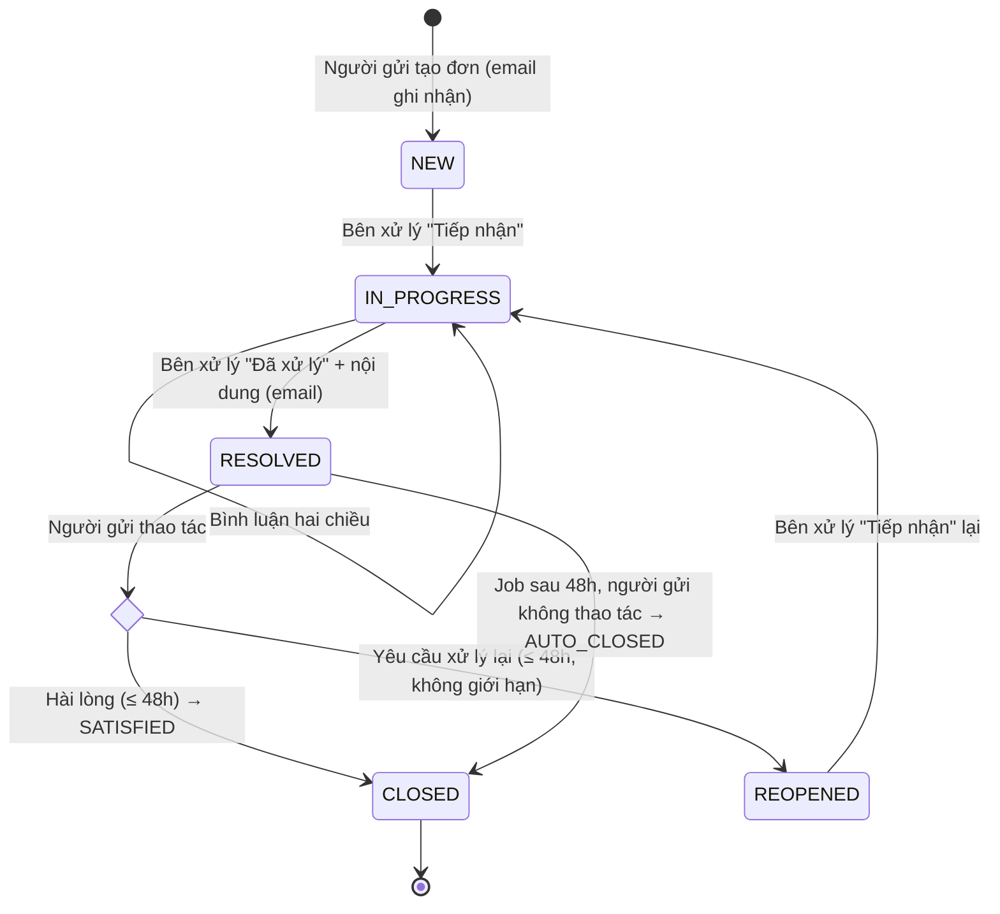
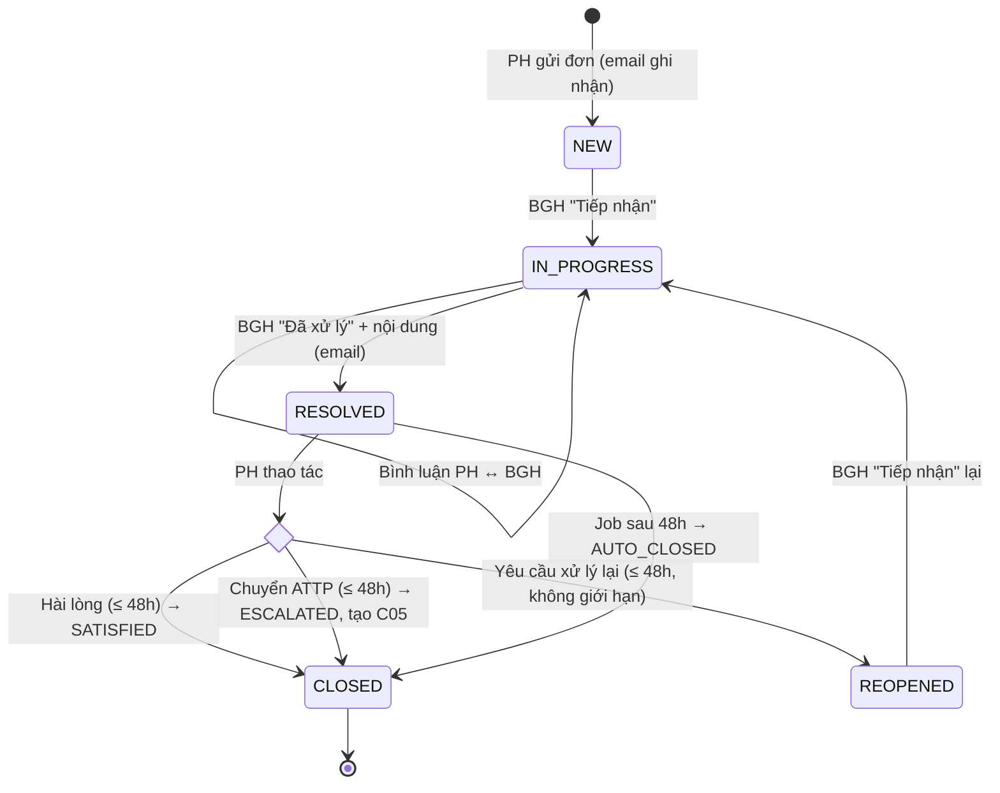
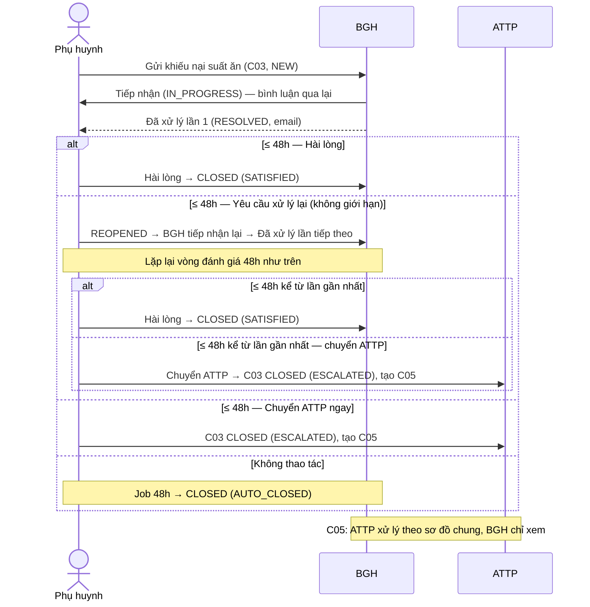
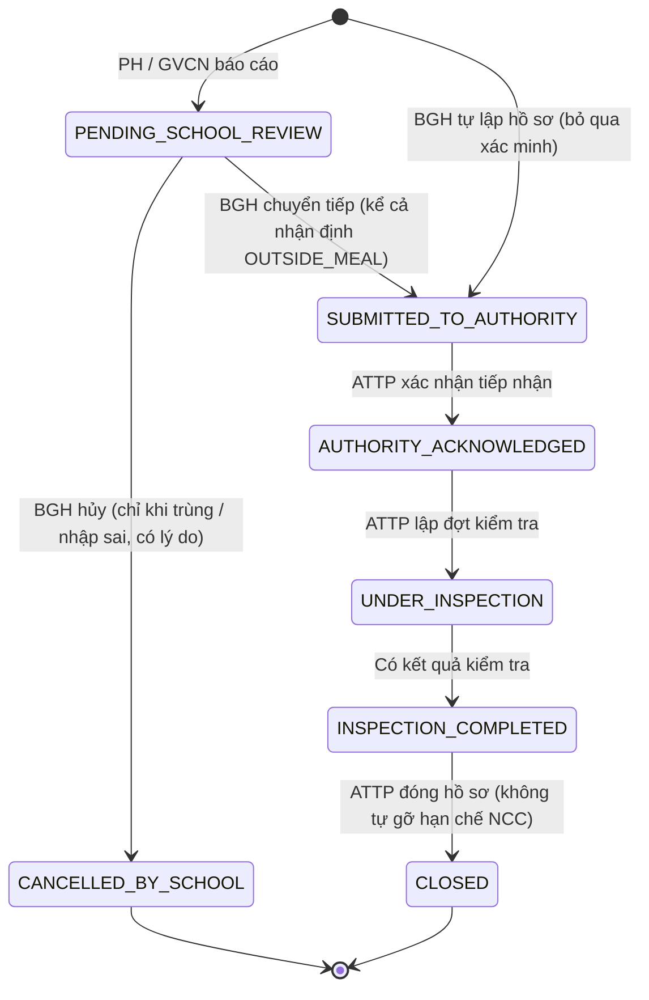
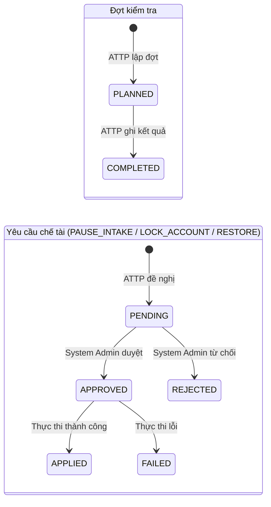

# Sơ đồ trạng thái — Khiếu nại (mô hình ticket) & Sự cố ATTP (bản đề xuất để duyệt)

> Đi kèm `complaint_db_design_plan_v3.md`. Mô hình khiếu nại tham chiếu `VOPS-13064-updated.md` (support ticket). Các điểm đánh dấu ⏳ đang chờ chốt.

## 1. Quy tắc chung cho mọi đơn khiếu nại (C01, C02, C03, C05, C06)

| #   | Quy tắc                                                                                                                                                                                                  |
| --- | -------------------------------------------------------------------------------------------------------------------------------------------------------------------------------------------------------- |
| R1  | **Hai lớp trạng thái**: bên xử lý thấy trạng thái chi tiết + nhãn; người gửi chỉ thấy **Đang xử lý / Đã xử lý / Đã đóng**                                                                                |
| R2  | Bên nhận **chỉ có "Tiếp nhận"**, **không có "Từ chối"**                                                                                                                                                  |
| R3  | **Bình luận hai chiều** giữa người gửi và bên xử lý; bình luận **không sửa, không xóa**; **không** có bình luận nội bộ                                                                                   |
| R4  | Bên xử lý bấm **"Đã xử lý"** phải nhập nội dung xử lý (lưu như một bình luận loại `RESOLUTION`)                                                                                                          |
| R5  | Sau "Đã xử lý": trong **48h** kể từ lần "Đã xử lý" gần nhất, người gửi chọn một trong: **Hài lòng** (đơn đóng ngay), **Yêu cầu xử lý lại**, **Chuyển ATTP** (chỉ C03). **Không** có nút "Không hài lòng" |
| R6  | **"Yêu cầu xử lý lại" không giới hạn số lần**; mỗi lần mở lại, mốc 48h tính lại từ lần "Đã xử lý" kế tiếp                                                                                                |
| R6b | Lý do khi Yêu cầu xử lý lại / Chuyển ATTP: **tùy chọn**, không bắt buộc (nếu nhập thì lưu thành bình luận)                                                                                               |
| R6c | Người gửi bình luận được khi đơn ở `NEW`, `IN_PROGRESS`, `REOPENED`; bên xử lý phải **Tiếp nhận trước** mới được bình luận (chỉ ở `IN_PROGRESS`); không ai bình luận khi `RESOLVED`/`CLOSED`             |
| R7  | **Job tự đóng sau 48h** kể từ lần "Đã xử lý" gần nhất nếu người gửi không thao tác; sau mốc này mọi nút đều hết hiệu lực                                                                                 |
| R8  | Chỉ **C03** có thêm nút **"Chuyển ATTP"** (tạo đơn C05)                                                                                                                                                  |
| R9  | Chỉ gửi **email** (không có thông báo in-app) cho người gửi khi: tạo đơn thành công, bên xử lý bình luận mới, đơn chuyển "Đã xử lý". **Không** gửi khi đóng                                              |
| R10 | Tiêu đề đơn do hệ thống tự sinh theo loại đơn                                                                                                                                                            |

## 2. Các loại đơn

| Mã  | Loại                                                    | Người gửi                | Bên xử lý                               | "Yêu cầu xử lý lại" | "Chuyển ATTP" |
| --- | ------------------------------------------------------- | ------------------------ | --------------------------------------- | ------------------- | ------------- |
| C01 | Khiếu nại suất ăn                                       | GVCN                     | BGH                                     | Không giới hạn      | Không         |
| C02 | Phản ánh chất lượng nguyên liệu (theo chuyến giao / lô) | BGH, bếp, dinh dưỡng     | NCC của chuyến giao                     | Không giới hạn      | Không         |
| C03 | Khiếu nại suất ăn                                       | Phụ huynh (Ban đại diện) | BGH                                     | Không giới hạn      | **Có**        |
| C05 | Khiếu nại leo thang (sinh từ C03)                       | Phụ huynh                | ATTP phường/xã của trường (BGH chỉ xem) | Không giới hạn      | Không         |
| C06 | Khiếu nại hệ thống                                      | Mọi vai trò              | System Admin                            | Không giới hạn      | Không         |

## 3. Trạng thái lưu trong DB và cách hiển thị (hai lớp)

| Trạng thái DB | Bên xử lý thấy                                                                    | Người gửi thấy | Ý nghĩa                                     |
| ------------- | --------------------------------------------------------------------------------- | -------------- | ------------------------------------------- |
| `NEW`         | **Đơn mới**                                                                       | Đang xử lý     | Vừa gửi, chờ tiếp nhận                      |
| `IN_PROGRESS` | **Đang xử lý** (nhãn phụ **Có tin nhắn mới** nếu bình luận cuối là của người gửi) | Đang xử lý     | Đã tiếp nhận, đang trao đổi                 |
| `REOPENED`    | **Yêu cầu xử lý lại**                                                             | Đang xử lý     | Người gửi không hài lòng, chờ tiếp nhận lại |
| `RESOLVED`    | **Đã xử lý**                                                                      | Đã xử lý       | Chờ người gửi đánh giá                      |
| `CLOSED`      | **Đã đóng** (kèm lý do)                                                           | Đã đóng        | Kết thúc                                    |

Lý do đóng (`close_reason`): `SATISFIED` (hài lòng), `ESCALATED` (C03 đã chuyển ATTP), `AUTO_CLOSED` (job 48h).

"Có tin nhắn mới" là **nhãn tính toán**, không phải trạng thái lưu.

---

## 4. Sơ đồ trạng thái chung (C01, C02, C05, C06)

## 5. Sơ đồ C03 — có thêm "Chuyển ATTP"

- "Chuyển ATTP" dùng được sau **bất kỳ lần "Đã xử lý" nào**, trong 48h kể từ lần gần nhất.
- Sau khi chuyển, C03 đóng (`ESCALATED`) và sinh **một** đơn C05 (mỗi C03 tối đa 1 C05). C05 chạy theo sơ đồ chung ở mục 4, phụ huynh yêu cầu ATTP xử lý lại không giới hạn.
- BGH xem được C05 của trường, gồm cả bình luận PH ↔ ATTP (chỉ đọc).

## 6. Hành động theo trạng thái

| Trạng thái         | Người gửi được làm                                   | Bên xử lý được làm  |
| ------------------ | ---------------------------------------------------- | ------------------- |
| `NEW`              | Bình luận                                            | Tiếp nhận           |
| `IN_PROGRESS`      | Bình luận                                            | Bình luận, Đã xử lý |
| `REOPENED`         | Bình luận                                            | Tiếp nhận lại       |
| `RESOLVED` (≤ 48h) | Hài lòng / Yêu cầu xử lý lại / Chuyển ATTP (chỉ C03) | —                   |
| `RESOLVED` (> 48h) | — (job đã đóng `AUTO_CLOSED`)                        | —                   |
| `CLOSED`           | Chỉ xem                                              | Chỉ xem             |

## 7. Luồng C03 → C05 (nhìn liền mạch)

## 8. Các điểm đã chốt

| #   | Chốt                                                                                                                      |
| --- | ------------------------------------------------------------------------------------------------------------------------- |
| Q-a | Hài lòng (đóng ngay), Yêu cầu xử lý lại, Chuyển ATTP đều trong **48h** kể từ lần "Đã xử lý" gần nhất; quá 48h job tự đóng |
| Q-b | Lý do **không bắt buộc**                                                                                                  |
| Q-c | Người gửi bình luận ở `NEW`, `IN_PROGRESS`, `REOPENED`                                                                    |
| Q-d | Bên xử lý phải **Tiếp nhận** trước mới được bình luận                                                                     |
| Q-e | BGH xem cả bình luận C05 (chỉ đọc)                                                                                        |
| Q-f | **Bỏ** nút "Không hài lòng"; "Yêu cầu xử lý lại" **không giới hạn** số lần (mọi loại đơn, kể cả C05)                      |

---

## Báo cáo sự cố ATTP (miền riêng, không phải đơn khiếu nại)

| Trạng thái               | Ý nghĩa                 | Người thao tác |
| ------------------------ | ----------------------- | -------------- |
| `PENDING_SCHOOL_REVIEW`  | Chờ BGH xác minh sơ bộ  | PH / GVCN tạo  |
| `CANCELLED_BY_SCHOOL`    | Hủy vì trùng / nhập sai | BGH            |
| `SUBMITTED_TO_AUTHORITY` | Đã gửi ATTP             | BGH            |
| `AUTHORITY_ACKNOWLEDGED` | ATTP đã tiếp nhận       | ATTP           |
| `UNDER_INSPECTION`       | Đang kiểm tra           | ATTP           |
| `INSPECTION_COMPLETED`   | Đã có kết quả kiểm tra  | ATTP           |
| `CLOSED`                 | Đóng hồ sơ              | ATTP           |

- Người báo (PH / GVCN) xem được tiến độ và kết luận kiểm tra của ATTP; hồ sơ BGH tự lập thì PH / GVCN không xem được.
- Kết quả kiểm tra của ATTP **ghi một lần, không sửa** (Q26).

### Đợt kiểm tra & chế tài NCC (chạy song song trong hồ sơ sự cố)

