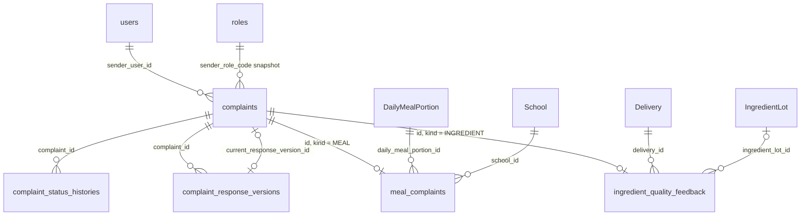

# Architecture & Migration Plan: Complaint Supertype & Response Versioning Foundation (PR1)

**Feature Branch**: `refactor/complaint-supertype`

**Created**: 2026-11-18

**Status**: Ready for Implementation

---

## 1. Kiến trúc CSDL & Class-Table Inheritance

### 1.1. Sơ đồ thực thể quan hệ (ERD)

### 1.2. Chiến lược Sequence mã khiếu nại dùng chung
1. Đổi tên hoặc kế thừa sequence hiện có `foodprint.ingredient_quality_feedback_complaint_code_seq` thành `foodprint.complaint_code_seq`.
2. Định dạng mã tuân thủ chuẩn: `FP-CP-00001` (dùng tiện ích có sẵn `src/utils/complaint-code.ts`).
3. Giá trị sequence tối thiểu bằng số lượng bản ghi tổng hợp sau khi backfill toàn bộ `ingredient_quality_feedback` và `meal_complaints`.

---

## 2. Kịch bản Migration chi tiết & Rehearsal Plan

### 2.1. Trình tự thực thi trong Migration SQL
1. Tạo type `foodprint.complaint_kind` (`MEAL`, `INGREDIENT`, `AUTHORITY`, `SYSTEM`).
2. Mở rộng type `foodprint.complaint_status` để có `RESPONDED` (nếu chưa có).
3. Đổi tên sequence `foodprint.ingredient_quality_feedback_complaint_code_seq` thành `foodprint.complaint_code_seq`.
4. Tạo bảng `foodprint.complaints` và bảng `foodprint.complaint_response_versions`.
5. Tạo bảng `foodprint.complaint_status_histories`.
6. **Migrate dữ liệu từ `ingredient_quality_feedback` lên `complaints`**:
   - `id`: Giữ nguyên UUID.
   - `kind`: `'INGREDIENT'`.
   - `complaint_code`: Giữ nguyên mã `FP-CP-` đã cấp.
   - `sender_user_id`: Từ `submitted_by_user_id`.
   - `sender_role_code`: Lấy từ `users.role_code` qua JOIN.
   - `sender_school_id`: Lấy từ `users.school_id`.
   - `title`: Lấy từ `ingredient_quality_feedback.title`.
   - `description`: Lấy từ `ingredient_quality_feedback.description`.
   - `status`: Lấy từ `ingredient_quality_feedback.status`.
   - `created_at`, `updated_at`: Giữ nguyên mốc thời gian cũ.
7. **Migrate phản hồi cũ của NCC vào `complaint_response_versions`**:
   - Với các đơn có `status = 'RESPONDED'` và `supplier_response IS NOT NULL`:
     - Chèn bản ghi `version = 1`, `content = supplier_response`, `responded_by_user_id = responded_by_user_id`, `created_at = COALESCE(responded_at, updated_at)`.
     - Cập nhật `complaints.current_response_version_id` trỏ tới version 1 này.
     - Chèn 1 dòng lịch sử vào `complaint_status_histories` (`from_status = 'SUBMITTED'`, `to_status = 'RESPONDED'`).
8. **Migrate dữ liệu từ `meal_complaints` lên `complaints`**:
   - Cấp mã `FP-CP-` mới bằng `nextval('foodprint.complaint_code_seq')` có thứ tự tăng dần theo `submitted_at ASC, id ASC`.
   - `id`: Giữ nguyên UUID.
   - `kind`: `'MEAL'`.
   - `sender_user_id`: Từ `submitted_by_user_id`.
   - `sender_role_code`: Lấy từ `users.role_code`.
   - `sender_school_id`: Lấy từ `classes.school_id` qua JOIN `daily_meal_portions` -> `classes`.
   - `title`: Đặt giá trị mặc định an toàn:
     - `MEAL_QUALITY` -> `'Phản ánh chất lượng món ăn'`
     - `FOOD_HYGIENE` -> `'Phản ánh vệ sinh an toàn thực phẩm'`
     - `HEALTH_ISSUE` -> `'Phản ánh vấn đề sức khỏe sau bữa ăn'`
     - `OTHER` -> `'Phản ánh suất ăn'`
   - `description`: Lấy từ `meal_complaints.description`.
   - `status`: Ánh xạ `RESOLVED` thành `RESPONDED`, các trạng thái khác giữ nguyên.
   - `created_at = submitted_at`, `updated_at = updated_at`.
9. **Migrate kết luận cũ của BGH vào `complaint_response_versions`**:
   - Với các đơn `meal_complaints` có `resolution IS NOT NULL`:
     - Chèn bản ghi `version = 1`, `content = resolution`, `responded_by_user_id = handled_by_user_id`, `created_at = COALESCE(resolved_at, updated_at)`.
     - Cập nhật `complaints.current_response_version_id` trỏ tới version này.
     - Chèn lịch sử vào `complaint_status_histories`.
10. **Bổ sung cột và ràng buộc cho 2 bảng con**:
    - `meal_complaints`: Thêm `school_id` (backfill từ `classes.school_id`), thêm `kind complaint_kind NOT NULL DEFAULT 'MEAL' CHECK (kind = 'MEAL')`. Thêm khóa ngoại FK `(id, kind)` trỏ tới `complaints(id, kind)`. Xóa các cột đã chuyển lên cha (`submitted_by_user_id`, `status`, `handled_by_user_id`, `resolution`, `resolved_at`, `submitted_at`, `updated_at`, `description`).
    - `ingredient_quality_feedback`: Thêm `kind complaint_kind NOT NULL DEFAULT 'INGREDIENT' CHECK (kind = 'INGREDIENT')`. Thêm khóa ngoại FK `(id, kind)` trỏ tới `complaints(id, kind)`. Xóa các cột đã chuyển lên cha (`complaint_code`, `submitted_by_user_id`, `status`, `supplier_response`, `responded_by_user_id`, `responded_at`, `created_at`, `updated_at`, `title`, `description`).
11. Cập nhật giá trị sequence `foodprint.complaint_code_seq` bảo đảm `max(val) >= count(*)`.

---

## 3. Rollback Plan

- **Kịch bản phục hồi**:
  1. Nếu phát sinh lỗi trong quá trình migration, toàn bộ migration được thực thi trong transaction đơn (`BEGIN ... COMMIT`) nên PostgreSQL sẽ tự động rollback toàn bộ cấu trúc về trạng thái ban đầu.
  2. Bổ sung script down migration dự phòng để khôi phục cấu trúc các cột cũ của `meal_complaints` và `ingredient_quality_feedback` từ bảng cha `complaints` và `complaint_response_versions` nếu cần rollback sau khi deploy.

---

## 4. Tương thích ngược tầng Backend (Code Modules)

### 4.1. Module `feedback` (`/api/meal-complaints`)
- **Repository (`feedback.repository.ts`)**:
  - Truy vấn dữ liệu qua quan hệ Prisma giữa `MealComplaint` và `Complaint` (hoặc `Complaint` với `mealComplaint`).
  - Lấy `title`, `description`, `status`, `senderUser`, `complaintCode` từ bảng cha.
  - Lấy `resolution`, `resolvedAt`, `handledByUser` từ `currentResponseVersion`.
  - Phép tạo đơn `create`: Tạo `complaints` và `meal_complaints` trong cùng 1 transaction `Serializable`.
- **Service (`feedback.service.ts`)**:
  - Ánh xạ hai chiều `RESPONDED` ở DB $\leftrightarrow$ `RESOLVED` ở API Response/Request DTO.
  - Các hàm kiểm tra phân quyền và điều kiện nghiệp vụ giữ nguyên 100%.

### 4.2. Module `ingredient-quality-feedback` (`/api/ingredient-quality-feedback`)
- **Repository (`ingredient-quality-feedback.repository.ts`)**:
  - Đổi tên sequence trong hàm `nextComplaintCodeSequence` trỏ tới `foodprint.complaint_code_seq`.
  - Điều chỉnh các hàm select list/detail để đọc `complaintCode`, `title`, `description`, `status` từ bảng cha `Complaint` và `supplierResponse`, `respondedAt` từ `currentResponseVersion`.
  - Hàm `respondIfSubmitted`: Thực hiện trong transaction gồm:
    1. Cập nhật `Complaint.status = 'RESPONDED'`.
    2. Tạo `ComplaintResponseVersion` với `version = 1`.
    3. Cập nhật `Complaint.currentResponseVersionId`.
    4. Tạo bản ghi `ComplaintStatusHistory`.
- **Service & Contract**:
  - Giữ nguyên hợp đồng `POST /api/ingredient-quality-feedback/:id/response`.
  - Trả về cùng Response DTO, cùng mã lỗi (409 nếu đã phản hồi).
