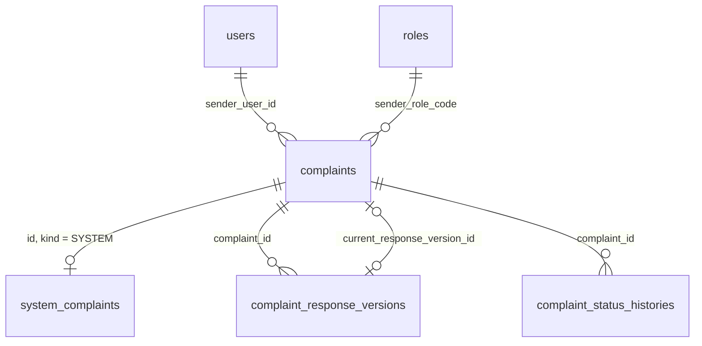

# Technical Implementation Plan: System Complaint Management (C06)

**Feature Slug**: `system-complaint-management`  
**Target Branch**: `feat/system-complaint-management`  
**Created**: 2026-11-18  
**Status**: Ready for Implementation

---

## 1. Architecture & Entity-Relationship Design



- Bảng con `system_complaints` liên kết với bảng cha `complaints` qua composite foreign key `(id, kind)`.
- Dãy mã sử dụng chung sequence `foodprint.complaint_code_seq` với tiền tố `FP-CP-`.

---

## 2. Database Migration

Migration SQL `prisma/migrations/20261124000100_system_complaint/migration.sql`:

1. Tạo bảng `foodprint.system_complaints` với `id`, `kind DEFAULT 'SYSTEM'`, CHECK `kind = 'SYSTEM'`, UNIQUE `(id, kind)`, FK `(id, kind) REFERENCES complaints(id, kind)`.
2. Tạo index cần thiết phục vụ tìm kiếm.

---

## 3. Module Design (`src/modules/system-complaint/`)

### 3.1 Cấu trúc thư mục

```
src/modules/system-complaint/
├── system-complaint.repository.ts
├── system-complaint.service.ts
├── system-complaint.validation.ts
├── system-complaint.routes.ts
└── index.ts
```

### 3.2 Logic Nghiệp vụ

1. **Tạo khiếu nại (`create`)**:
   - Chạy trong `$transaction(isolationLevel: "Serializable")`.
   - Lấy next sequence `foodprint.complaint_code_seq`, format `FP-CP-xxxxx`.
   - Chèn bản ghi vào `complaints` với `kind = 'SYSTEM'`, `status = 'SUBMITTED'`.
   - Chèn bản ghi vào `system_complaints` với `id = complaint.id`, `kind = 'SYSTEM'`.
   - Chèn bản ghi khởi tạo vào `complaint_status_histories`.
2. **Xem danh sách (`listOwn` & `listAdmin`)**:
   - `listOwn`: Lọc `kind = 'SYSTEM'` AND `senderUserId = auth.id`.
   - `listAdmin`: Yêu cầu quyền `system_complaint.view` hoặc role `SYSTEM_ADMIN`. Lọc `kind = 'SYSTEM'`, hỗ trợ lọc `status`, tìm kiếm theo `complaintCode` hoặc `title`.
3. **Phản hồi khiếu nại (`respond`)**:
   - Kiểm tra quyền `system_complaint.respond`.
   - Chạy trong `$transaction(isolationLevel: "Serializable")`.
   - Tìm khiếu nại, xác nhận `kind = 'SYSTEM'`.
   - Nếu chưa có phản hồi: tạo `ComplaintResponseVersion` version 1, previousVersionId = NULL. Cập nhật `Complaint.status = 'RESPONDED'`, `Complaint.currentResponseVersionId = version.id`. Ghi `ComplaintStatusHistory`.
   - Nếu đã có phản hồi: yêu cầu `changeReason`. Tạo version mới `version = current.version + 1`, previousVersionId = current.id. Cập nhật `currentResponseVersionId`. Ghi `ComplaintStatusHistory`.

---

## 4. Verification & Testing Strategy

- Unit test & Module integration test:
  - Test tạo khiếu nại C06 cấp đúng mã sequence.
  - Test cách ly dữ liệu: user thường chỉ thấy đơn của mình.
  - Test System Admin phản hồi version 1 và cập nhật version 2+ kèm lý do thay đổi.
  - Test validation Zod từ chối payload không hợp lệ.
  - Chạy `node tests/spec-gate.test.mjs` kiểm tra Spec Gate.
  - Chạy `npm run typecheck` và `npm run build`.
